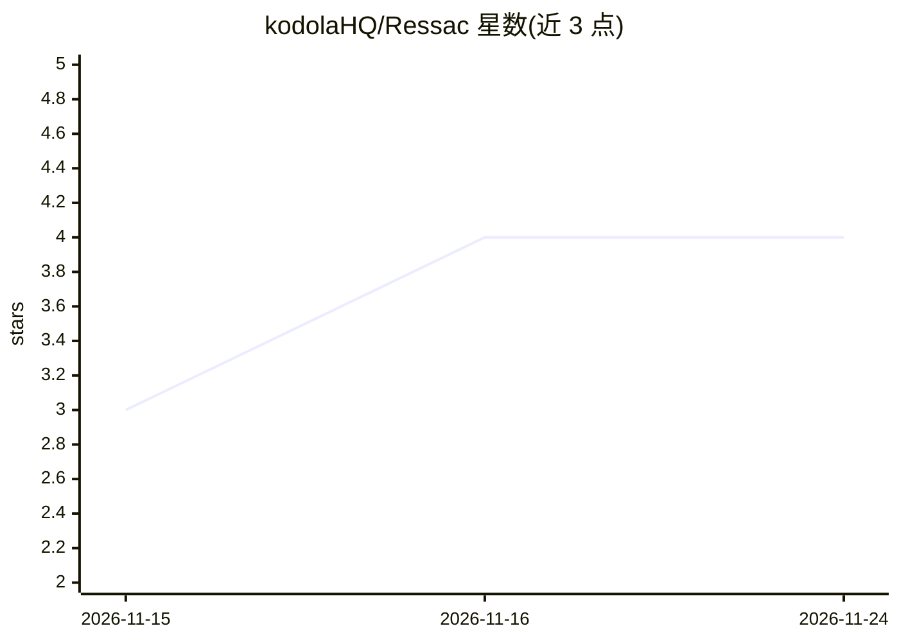

# kodolaHQ/Ressac

⭐ 4 · TypeScript · MPL-2.0 · 推送 2026-11-22 · [GitHub](https://github.com/kodolaHQ/Ressac) · [官网](https://getressac.app) · 组织维护

**基于 Firefox 的 macOS 浏览器，可开启浏览代理**

基于 Firefox（MPL 2.0）的开源浏览器，处于封闭测试阶段，仅支持 macOS 13.3+ Apple Silicon。默认为无注册的常规浏览器（竖排侧栏、spaces、命令栏、从 Arc/Chrome 等导入）；AI 默认关闭，开启后在沙盒容器内以用户自己的 Claude Code 或 Codex 账户运行浏览代理，可代为浏览网页、填写购买对比回顾、构建站点应用与扩展；本地小模型（d1-2B、EmbeddingGemma）支持语义历史搜索与工作流决策，llama-server 随应用内置。

## 筛选速览

| 维度 | 判定 | 备注 |
|---|---|---|
| AI 角色 | `ai-enhanced` | 去掉 AI 部分产品仍成立 |
| 许可风险 | `permissive` | MPL-2.0 |
| 部署形态 | `library` | 以包/库形式分发 |
| 模型依赖 | local-ok | 支持本地模型 |
| 硬件要求 | — | 无带数字的原话,不猜 |
| 安装摩擦 | `low` | 无编译、无系统依赖或容器化 |
| 成熟度 | `idea` | |

## 能力要点

- 沙盒容器内运行 Claude Code/Codex 代理，网络经域名白名单代理
- 本地模型 d1-2B 与 EmbeddingGemma 支持语义搜索与工作流，可选自有 Ollama
- 默认关闭 AI、无账户、浏览数据留在本地
- 支持导入 9 款浏览器数据，兼容 Firefox 扩展

## 适用场景

- 作为安静的日常浏览器管理标签页与 spaces
- 让代理代为浏览网页并整理购买对比资料
- 用本地模型按语义找回访问过的页面
- 让代理构建站点应用与浏览器扩展

## 场景标签

`语义搜索` `浏览器自动化` · 领域:效率与自动化

## 证据(README 行号)

> L13: Firefox under the hood, a quiet sidebar, nothing to sign up for, nothing to switch on.
> L27: ## When you're ready: switch on the AI
> L60: - **AI stays off until you switch it on.** The agent's machine, the local models and the agent start only once you 

## 星数曲线

2026-11-15 3 → 2026-11-24 4（+1）

---
*卡片 v1 · prompt 1.4 · 生成 2026-11-21 · 置信度 mid · 依据 README sha `ac261e374b26` · [字段定义](../../DATASET.md)*
