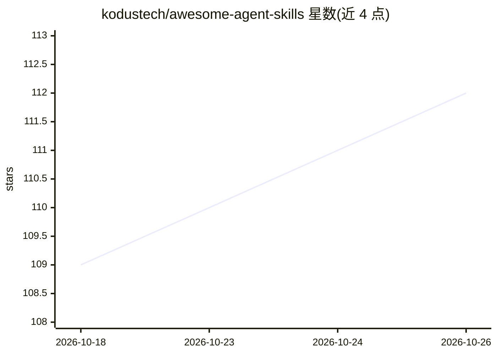

# kodustech/awesome-agent-skills

⭐ 112 · 推送 2026-10-01 · [GitHub](https://github.com/kodustech/awesome-agent-skills) · [官网](https://ai-skills.io/) · 组织维护

**面向软件工程 AI 编码 agent 的技能策展清单**

由 Kodus 工程团队维护的 agent 技能清单：收录以 SKILL.md 格式定义的模块化能力包，供 Claude Code、Codex、Cursor 等 AI 编码 agent 按需加载。条目按前端开发、后端开发、DevOps、测试与 QA 等类别组织，覆盖 PyTorch 算子扩展、WCAG 可访问性审计、MLOps 流水线、Terraform 状态管理、代码模型评测基准等场景。清单说明技能采用渐进式披露机制：先加载轻量元数据，相关时才加载完整指令。

## 筛选速览

| 维度 | 判定 | 备注 |
|---|---|---|
| AI 角色 | `ai-knowledge` | 知识聚合/清单类 |
| 许可风险 | `none` | — |
| 部署形态 | `None` |  |
| 模型依赖 | — | README 未给出锁定关系 |
| 硬件要求 | — | 无带数字的原话,不猜 |
| 安装摩擦 | `low` | 无编译、无系统依赖或容器化 |
| 成熟度 | — | 结构信号不足 |

## 能力要点

- 条目以 SKILL.md 格式组织，含使用时机、执行方式与约束
- 按前端/后端/DevOps/测试 QA 等类别组织技能条目
- 技能采用渐进式披露：轻量元数据先行，相关时加载完整指令

## 适用场景

- 为 Claude Code / Cursor 等编码 agent 查找可用技能
- 了解 SKILL.md 技能的触发条件与组织方式
- 浏览软件工程各领域的现成 agent 能力包

## 场景标签

`精选清单` · 领域:学习与行业

## 证据(README 行号)

> L3: A curated list of agent skills for software engineering
> L5: > **Maintainer Note:** This list is curated and maintained by the engineering team at **Kodus**. We love open source

## 星数曲线

2026-10-18 109 → 2026-10-26 112（+3）

---
*卡片 v1 · prompt 1.4 · 生成 2026-10-23 · 置信度 high · 依据 README sha `dc8961069ecd` · [字段定义](../../DATASET.md)*
