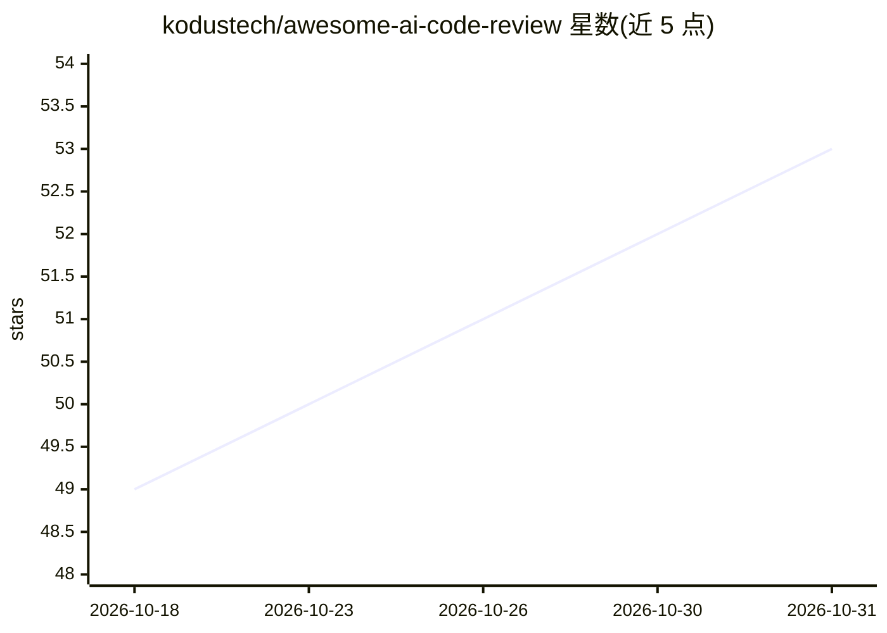

# kodustech/awesome-ai-code-review

⭐ 53 · 推送 2026-06-28 · [GitHub](https://github.com/kodustech/awesome-ai-code-review) · [官网](https://aicodereviews.io) · 组织维护

**AI 代码评审工具与论文策展清单（Kodus 团队维护）**

由 Kodus 工程团队维护的 awesome list：收录自动化 PR 评审 agent（含 CodeRabbit、Greptile、Cursor Bugbot、开源的 Gito 等）、IDE 助手（Copilot、Cursor、Claude Code 等）、安全与静态分析 AI 工具、CLI 本地工具、基准测试（SWE-bench、HumanEval 等）以及研究论文。README 声明不做工具对比且维护方自认存在偏向，将自家产品 Kodus 列在首位。面向选型调研的开发者与团队，许可为 CC0。

## 筛选速览

| 维度 | 判定 | 备注 |
|---|---|---|
| AI 角色 | `ai-knowledge` | 知识聚合/清单类 |
| 许可风险 | `none` | — |
| 部署形态 | `None` |  |
| 模型依赖 | — | README 未给出锁定关系 |
| 硬件要求 | — | 无带数字的原话,不猜 |
| 安装摩擦 | `low` | 无编译、无系统依赖或容器化 |
| 成熟度 | — | 结构信号不足 |

## 能力要点

- 按 7 个类别组织：PR agent、IDE 助手、论文、安全分析、CLI、基准测试等
- 收录多条开源 AI 评审工具（Gito、Ivy Tendril、Signum 等）
- 附研究论文与基准测试（SWE-bench、HumanEval、ReviewBenchLite）
- 维护方声明清单不用于工具对比，且标注自身偏向

## 适用场景

- 为团队调研可用的 AI 代码评审工具与 PR agent
- 查找 AI 代码评审相关研究论文与基准测试
- 了解开源/自托管 AI 评审工具选项（含支持 Ollama/vLLM 的方案）

## 场景标签

`精选清单` · 领域:学习与行业

## 证据(README 行号)

> L3: A curated list of AI-powered tools, agents, and platforms dedicated to automating code reviews, enforcing guidelines
> L61: ## Key Research & Papers

## 星数曲线

2026-10-18 49 → 2026-10-31 53（+4）

---
*卡片 v1 · prompt 1.4 · 生成 2026-10-24 · 置信度 high · 依据 README sha `38d5b0f28351` · [字段定义](../../DATASET.md)*
