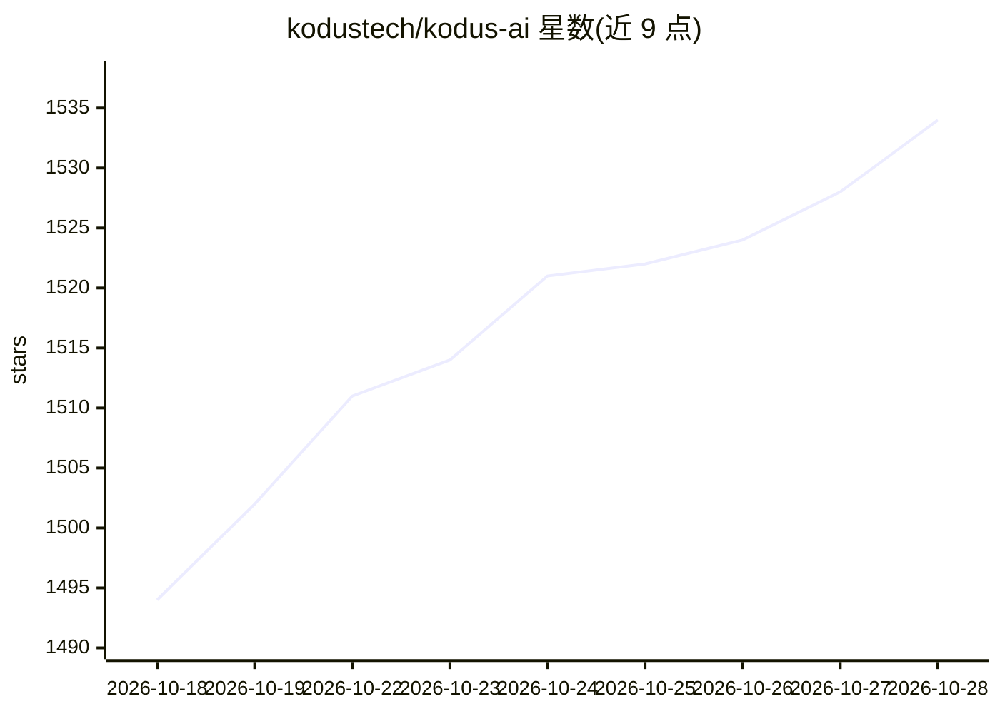

# kodustech/kodus-ai

⭐ 1,534 · TypeScript · NOASSERTION · 推送 2026-10-27 · [GitHub](https://github.com/kodustech/kodus-ai) · [官网](https://kodus.io) · 组织维护

**开源可自托管的 AI 代码评审工具，自选 LLM 与自备 API key**

面向开发团队的 AI 代码评审系统：Kody 在 GitHub、GitLab、Bitbucket、Azure DevOps 和 Forgejo 的 PR 中执行带上下文的代码评审，按严重级别标记风险并给出修改建议。支持 BYOK，可接 Claude、GPT-5、Gemini、Llama、GLM、Kimi 或任意 OpenAI 兼容端点，LLM 费用直付模型商。可自然语言定义评审规则，追踪未实现建议与技术债指标。提供云托管、Docker 自托管（2 核/8GB 内存/60GB 磁盘起，需申请试用许可）与 CLI 三种使用方式。

## 筛选速览

| 维度 | 判定 | 备注 |
|---|---|---|
| AI 角色 | `ai-native` | 本体是模型或模型工具 |
| 许可风险 | `none` | NOASSERTION |
| 部署形态 | `None` |  |
| 模型依赖 | — | README 未给出锁定关系 |
| 硬件要求 | — | 无带数字的原话,不猜 |
| 安装摩擦 | `low` | 无编译、无系统依赖或容器化 |
| 成熟度 | — | 结构信号不足 |

## 能力要点

- BYOK：支持 OpenAI/Anthropic/Gemini/Vertex AI/Novita 及任意 OpenAI 兼容端点
- 自然语言定义 Kody Rules，按组织/仓库/路径/评审范围应用
- Docker 自托管 + CLI（kodus review 支持 working tree/staged/branch/commit）+ CI/CD
- Kody Issues 追踪已关闭 PR 中未实现建议，后续 PR 出现修复时自动解决

## 适用场景

- 在 PR 流程中自动评审代码并按严重级别标记风险
- 团队用自然语言沉淀架构与安全评审规范
- 内网环境自托管 AI 评审，代码不出自己基础设施
- 在终端或 CI/CD 流水线中本地跑 AI 评审

## 场景标签

`代码审查` · 领域:编码与开发

## 证据(README 行号)

> L13:  Open source AI code review you can self-host, with the LLM you choose.
> L35: - **Model Agnostic**: Use Claude, GPT-5, Gemini, Llama, GLM, Kimi or any OpenAI-compatible endpoint.
> L78: Kody does more than summarize diffs. It reviews code with context, flags risks by severity, and suggests concrete f

## 星数曲线

2026-10-18 1,494 → 2026-10-28 1,534（+40）

---
*卡片 v1 · prompt 1.4 · 生成 2026-10-21 · 置信度 high · 依据 README sha `0c400d1fbd3d` · [字段定义](../../DATASET.md)*
