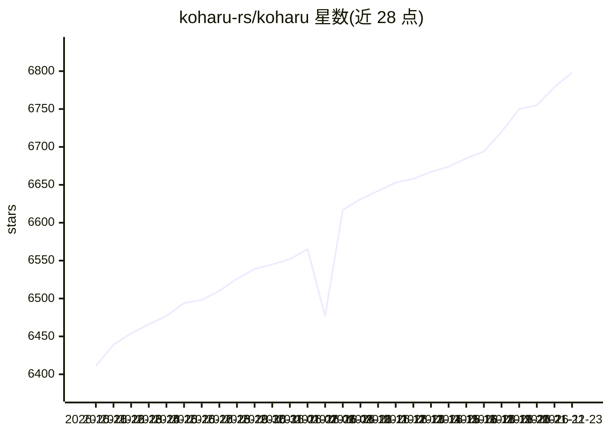

# koharu-rs/koharu

⭐ 6,798 · Rust · Apache-2.0 · 推送 2026-11-22 · [GitHub](https://github.com/koharu-rs/koharu) · [官网](https://koharu.rs) · 个人维护 · 中文 README

**本地运行 ML 模型的漫画翻译桌面工具**

以 Rust 编写的漫画翻译应用，提供本地优先的工作流：对页面做检测分割、OCR、LLM 翻译与修复（inpainting），并在 GPU 画布上完成文字排版与导出。视觉模型与 LLM 均可在本地运行以保护数据隐私；翻译可用本地 GGUF 模型或托管 API。提供 Windows/macOS/Linux 发行版安装包，支持 PNG/CBZ/分层 PSD 导出，并内置 MCP 服务器供 AI agent 调用。部分模型带有非商用许可（如 CC BY-NC-SA）。

## 筛选速览

| 维度 | 判定 | 备注 |
|---|---|---|
| AI 角色 | `ai-native` | 本体是模型或模型工具 |
| 许可风险 | `permissive` | Apache-2.0 |
| 部署形态 | `desktop` | 安装包/桌面程序 |
| 模型依赖 | local-ok | 支持本地模型 |
| 硬件要求 | — | 无带数字的原话,不猜 |
| 安装摩擦 | `medium` | 含编译或系统依赖之一 |
| 成熟度 | — | 结构信号不足 |

## 能力要点

- 检测、OCR、翻译、修复可按页或项目范围选择性执行
- 本地 GGUF 推理与托管 LLM 提供商（含 BYOK 与订阅登录）
- 支持 CUDA/ROCm/Metal/Vulkan 四类 GPU 加速
- 多语言文字整形与排版：竖排 CJK、RTL、字体回退、自动适配

## 适用场景

- 把日文漫画批量翻译成中/韩/英等语言并导出可编辑的分层 PSD
- 在本地离线环境下翻译漫画以保持数据隐私
- 手动清理与重排译文文字后直接导出发布格式

## 场景标签

`图像视频处理` `OCR` · 领域:感知与多模态

## 证据(README 行号)

> L13: Koharu introduces a local-first workflow for manga translation, utilizing the power of ML to automate the process. 
> L29: - Local GGUF inference and hosted providers for LLM translation, including ChatGPT and Grok sign-in
> L39: Koharu supports CUDA on Windows and Linux, ROCm / HIP on x86-64 Windows and Linux, Metal on Apple silicon, and Vulk

## 星数曲线

2026-10-21 6,411 → 2026-11-23 6,798（+387）

---
*卡片 v1 · prompt 1.4 · 生成 2026-11-22 · 置信度 high · 依据 README sha `015e061425b6` · [字段定义](../../DATASET.md)*
