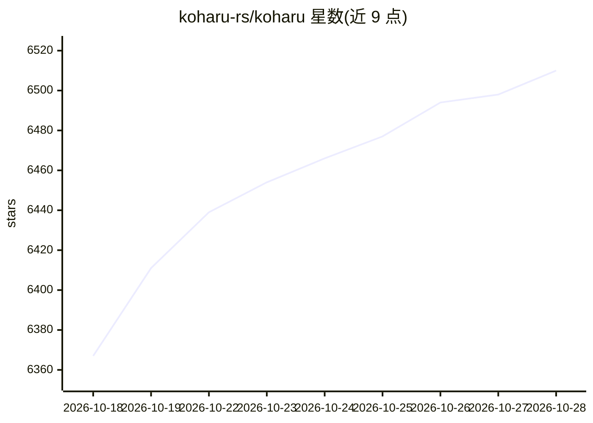

# koharu-rs/koharu

⭐ 6,526 · Rust · Apache-2.0 · 推送 2026-10-28 · [GitHub](https://github.com/koharu-rs/koharu) · [官网](https://koharu.rs) · 个人维护 · 中文 README

**本地优先的 ML 漫画翻译器（Rust），检测+OCR+修图+翻译一体**

Rust 编写的桌面漫画翻译应用：本地运行视觉模型与 LLM，流水线覆盖文本区域检测、多模态 OCR、生成式 inpainting 修图、翻译与校对，配套 WebGPU 画布做手动清理、文字排版（含竖排 CJK、RTL）与分层 PSD 导出。翻译可选本地 GGUF 模型（Qwen、Gemma 等）或云端 API（OpenAI、Claude、DeepL 等）。支持 CUDA/ROCm/Metal/Vulkan 加速与 CPU 推理，提供 Windows/macOS/Linux 安装包、winget 与 Homebrew 安装。

## 筛选速览

| 维度 | 判定 | 备注 |
|---|---|---|
| AI 角色 | `ai-native` | 本体是模型或模型工具 |
| 许可风险 | `permissive` | Apache-2.0 |
| 部署形态 | `desktop` | 安装包/桌面程序 |
| 模型依赖 | locked-api |  |
| 硬件要求 | — | 无带数字的原话,不猜 |
| 安装摩擦 | `medium` | 含编译或系统依赖之一 |
| 成熟度 | — | 结构信号不足 |

## 能力要点

- 检测/OCR/inpainting/翻译的选择式流水线
- 本地 GGUF 推理与多家云端 LLM 提供商
- WebGPU 画布支持手动清理、文字排版与 PSD 分层导出
- CUDA/ROCm/Metal/Vulkan 加速，无需完整 CUDA/ROCm SDK

## 适用场景

- 把日文漫画原图自动翻译成中文/其他语言
- 翻译后手动修图、调字并导出分层 PSD 交付
- 全程本地推理，避免漫画稿件外泄

## 场景标签

`OCR` `图像视频处理` · 领域:感知与多模态

## 证据(README 行号)

> L13: Koharu introduces a local-first workflow for manga translation, utilizing the power of ML to automate the process. 
> L29: - Local GGUF inference and hosted providers for LLM and machine-translation workflows
> L67: Koharu uses separate models for detection, OCR, inpainting, and translation. Vision and inpainting and translation 

## 星数曲线

2026-10-18 6,367 → 2026-10-28 6,510（+143）

---
*卡片 v1 · prompt 1.4 · 生成 2026-10-20 · 置信度 high · 依据 README sha `f1fad35cb23e` · [字段定义](../../DATASET.md)*
