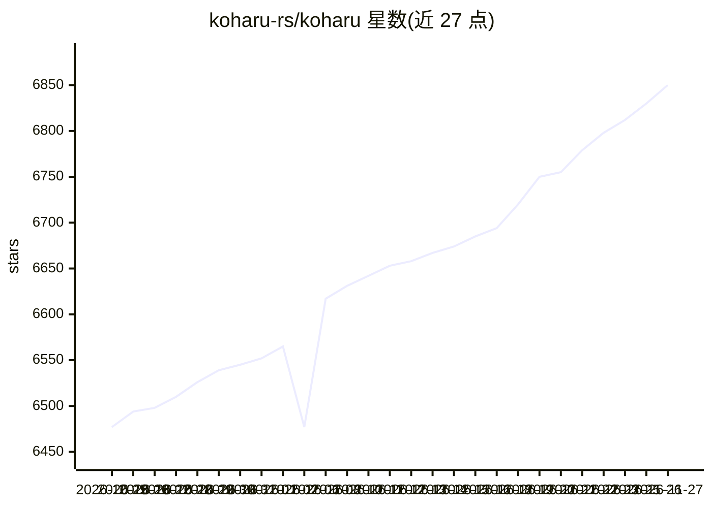

# koharu-rs/koharu

⭐ 6,850 · Rust · Apache-2.0 · 推送 2026-11-26 · [GitHub](https://github.com/koharu-rs/koharu) · [官网](https://koharu.rs) · 个人维护 · 中文 README

**本地优先的 ML 漫画翻译工具：检测/OCR/修补/翻译一条龙**

用 Rust 编写的漫画翻译桌面应用，将目标检测、OCR、图像修补与 LLM 翻译组合为可分步执行的流水线，支持面板/气泡/文字/音效的检测分割，日中韩英四语 OCR，Generative inpainting 去字与画面重建，多语言排版与 PNG/CBZ/PDF/PSD 导出。视觉模型与 LLM 均默认在本地运行以保留数据，也可接入托管云服务；另提供 MCP server 供 AI agent 驱动工作流。通过 winget、Homebrew 或 release 安装包分发，开发构建需 Rust、Bun 与 LLVM。

## 筛选速览

| 维度 | 判定 | 备注 |
|---|---|---|
| AI 角色 | `ai-native` | 本体是模型或模型工具 |
| 许可风险 | `permissive` | Apache-2.0 |
| 部署形态 | `desktop` | 安装包/桌面程序 |
| 模型依赖 | local-ok | 支持本地模型 |
| 硬件要求 | — | 无带数字的原话,不猜 |
| 安装摩擦 | `medium` | 含编译或系统依赖之一 |
| 成熟度 | — | 结构信号不足 |

## 能力要点

- 检测/OCR/翻译/修补按页面或项目范围选择性执行
- 本地 GGUF 推理与托管云服务（OpenAI、Anthropic、DeepSeek 等）均可用于翻译
- 支持 CUDA、ROCm/HIP、Metal、Vulkan 四类硬件加速
- Agent 驱动工作流，内置 MCP server

## 适用场景

- 汉化/翻译漫画并保留分层 PSD 供后期编辑
- 在本地离线环境完成漫画翻译以保护数据隐私
- 通过 MCP server 让 AI agent 自动化翻译流水线

## 场景标签

`图像视频处理` `目标检测` `OCR` · 领域:感知与多模态

## 证据(README 行号)

> L13: Koharu introduces a local-first workflow for manga translation, utilizing the power of ML to automate the process. 
> L29: - Local GGUF inference and hosted providers for LLM translation, including ChatGPT and Grok sign-in

## 星数曲线

2026-10-25 6,477 → 2026-11-27 6,850（+373）

---
*卡片 v1 · prompt 1.4 · 生成 2026-11-27 · 置信度 high · 依据 README sha `77e7d7a30cb1` · [字段定义](../../DATASET.md)*
