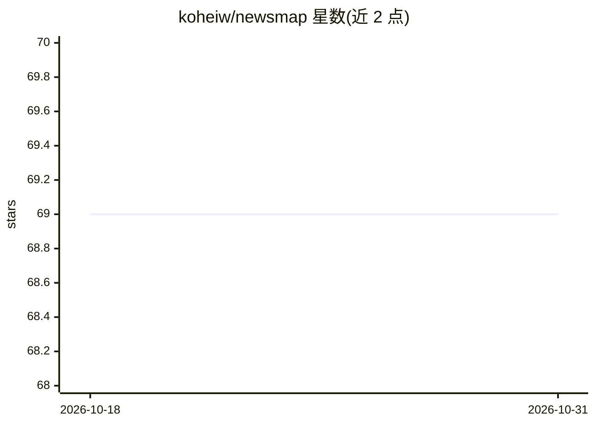

# koheiw/newsmap

⭐ 69 · R · NOASSERTION · 推送 2026-05-14 · [GitHub](https://github.com/koheiw/newsmap) · 个人维护

**R 包：半监督地理文档分类器，按国家归类新闻文本**

基于半监督贝叶斯模型的地理文档分类 R 包：从语料库自动构建大规模地理词典，结合 12 种语言（英德法西葡俄意阿土希日中）的种子词典，对文本进行地理位置分类，输出国家等地理标签。配合 quanteda 做文本预处理，示例演示在 2014 年 Yahoo 新闻语料上训练并预测新闻的国家归属。自 0.6 版起发布于 CRAN，算法细节见已发表论文。

## 筛选速览

| 维度 | 判定 | 备注 |
|---|---|---|
| AI 角色 | `ai-native` | 本体是模型或模型工具 |
| 许可风险 | `none` | NOASSERTION |
| 部署形态 | `None` |  |
| 模型依赖 | — | README 未给出锁定关系 |
| 硬件要求 | — | 无带数字的原话,不猜 |
| 安装摩擦 | `low` | 无编译、无系统依赖或容器化 |
| 成熟度 | — | 结构信号不足 |

## 能力要点

- 半监督贝叶斯模型做地理文档分类
- 从语料库自动构建地理词典
- 内置 12 种语言的种子词典
- 0.6 版起发布于 CRAN

## 适用场景

- 对新闻语料按国家做地理归类
- 文本分析流程中批量识别文档的地理焦点
- 多语言新闻的地域分布统计

## 场景标签

 · 领域:自然语言处理/文本分析

## 证据(README 行号)

> L12: Semi-supervised Bayesian model for geographical document classification.
> L14: corpus to accurate classify documents. Currently, the **newsmap**

## 星数曲线

2026-10-18 69 → 2026-10-31 69（+0）

---
*卡片 v1 · prompt 1.4 · 生成 2026-10-24 · 置信度 high · 依据 README sha `819381c74a65` · [字段定义](../../DATASET.md)*
