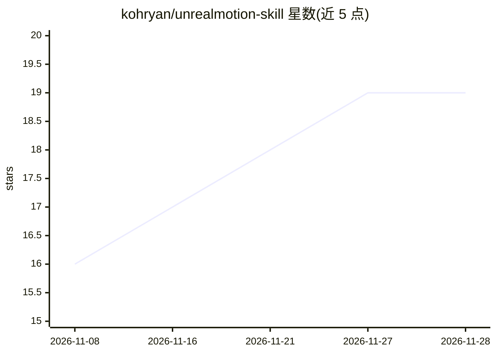

# kohryan/unrealmotion-skill

⭐ 19 · JavaScript · MIT · 推送 2026-11-04 · [GitHub](https://github.com/kohryan/unrealmotion-skill) · 个人维护 · 中文 README

**Codex 编程 agent 的提示词生成 3D 演示视频技能**

面向 Codex 编程 agent 的 skill（SKILL.md）：以 prompt → ImageGen 参考图 → Three.js 场景重建 → 本地渲染的管线生成无音频 MP4 演示/装配视频（默认 60 秒、9:16、1080×1920、30fps）。内置 CCORE ThreeJS-3D-Scenes 离线索引（4,146 场景，BM25 检索）与 NVIDIA SimReady 资产目录（2,677 个，按需取缩略图）；渲染依赖宿主自带 ImageGen 与本地 FFmpeg/Node/Python/Playwright 环境，不含模型训练。主要界面语言为印尼语。

## 筛选速览

| 维度 | 判定 | 备注 |
|---|---|---|
| AI 角色 | `ai-native` | 本体是模型或模型工具 |
| 许可风险 | `permissive` | MIT |
| 部署形态 | `library` | 以包/库形式分发 |
| 模型依赖 | — | README 未给出锁定关系 |
| 硬件要求 | — | 无带数字的原话,不猜 |
| 安装摩擦 | `medium` | 含编译或系统依赖之一 |
| 成熟度 | — | 结构信号不足 |

## 能力要点

- prompt→ImageGen→Three.js→MP4 的确定性本地渲染管线（cutaway/reassembly/数据图表 motion）
- CCORE 数据集离线索引 4,146 场景，BM25 检索并校验 SHA-256
- NVIDIA SimReady 2,677 资产目录按需取用（约 391 KB 索引）
- 通过 ~/.agents/skills symlink 或 installer 脚本注册为 Codex 个人技能

## 适用场景

- 让 Codex agent 从文字 brief 生成 3D 机制解释视频（MP4+可编辑源码）
- 制作 cutaway/装配/数据可视化类 motion graphics
- 用本地参考资产（SimReady/CCORE）保持场景一致性

## 场景标签

 · 领域:3D 动画/视频生成

## 证据(README 行号)

> L7: Skill untuk coding agent dengan pipeline **prompt → ImageGen → rekonstruksi Three.js → video explainer tanpa audio**
> L49: ## Instalasi skill di Codex
> L117: Agent membaca SKILL.md, menghasilkan referensi adegan yang konsisten melalui ImageGen bawaan host, menulis model/s

## 星数曲线

2026-11-08 16 → 2026-11-28 19（+3）

---
*卡片 v1 · prompt 1.4 · 生成 2026-11-18 · 置信度 mid · 依据 README sha `8bd886a69e19` · [字段定义](../../DATASET.md)*
