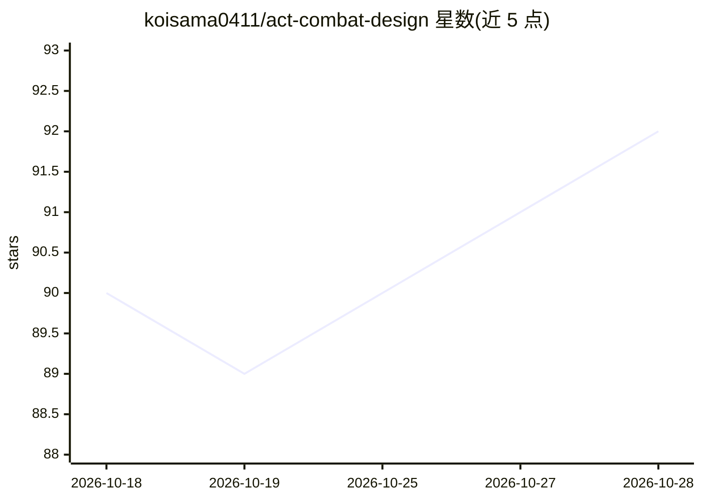

# koisama0411/act-combat-design

⭐ 92 · HTML · NOASSERTION · 推送 2026-07-14 · [GitHub](https://github.com/koisama0411/act-combat-design) · 个人维护 · 中文 README

**动作游戏战斗设计方法论知识库，供任意 AI agent 加载使用**

面向二次元/动作游戏的战斗策划方法论与行业知识库，以 SKILL.md 与 references 文件组织，供 Claude Code（作为 skill 安装、关键词自动触发）及 GPT/Cursor 等（作为 system prompt/上传文件加载）使用。流程为：填项目战斗约定模板 → 6 Phase 设计流程 → 产出角色/Boss/效果养成的 markdown 草稿与审阅级 HTML 及资源需求表。知识库含 46 条元规则、70+ 游戏借鉴库、打击感/数值/Boss AI 工程基线，正文为中文。自我更新功能为试验性且默认关闭。

## 筛选速览

| 维度 | 判定 | 备注 |
|---|---|---|
| AI 角色 | `ai-knowledge` | 知识聚合/清单类 |
| 许可风险 | `none` | NOASSERTION |
| 部署形态 | `None` |  |
| 模型依赖 | — | README 未给出锁定关系 |
| 硬件要求 | — | 无带数字的原话,不猜 |
| 安装摩擦 | `low` | 无编译、无系统依赖或容器化 |
| 成熟度 | — | 结构信号不足 |

## 能力要点

- 6 Phase 流程：约定模板 → 高层框架 → 逐招展开 → 需求拆解 → 审阅文档
- 46 条元规则 + 70+ 游戏跨游戏借鉴库 + Boss 范式库
- 产出角色分稿/完整稿、Boss 稿与资源需求 xlsx 生成脚本
- 试验性自我更新：洞察沉淀到本地 knowledge-local/，默认关闭

## 适用场景

- 让 AI agent 按自定项目约定设计玩家角色或 Boss
- 战斗策划产出可评审的 HTML 设计文档与落地资源表
- 查阅打击感参数、数值公式、Boss AI 等工程基线

## 场景标签

 · 领域:游戏开发/战斗策划知识

## 证据(README 行号)

> L10: **二次元 / 动作游戏（ACT）战斗设计专家** —— 一套可被任意 AI agent（Claude / GPT / Cursor…）使用的**战斗设计方法论 + 行业知识库**。
> L24: 背后配一座行业知识库：角色原型、Boss 范式、46 条元规则、70+ 游戏借鉴库、打击感 / 数值 / Boss AI 工程基线。
> L84: ├─ SKILL.md                 # 方法论入口（6 Phase 流程 + 引用索引）

## 星数曲线

2026-10-18 90 → 2026-10-28 92（+2）

---
*卡片 v1 · prompt 1.4 · 生成 2026-10-23 · 置信度 high · 依据 README sha `84a2f111ea95` · [字段定义](../../DATASET.md)*
