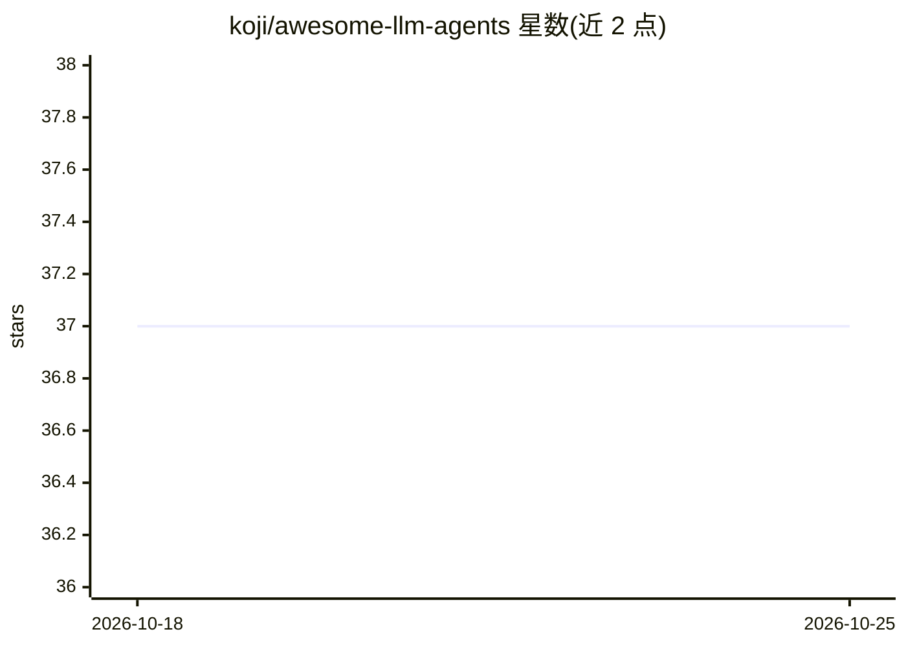

# koji/awesome-llm-agents

⭐ 37 · Python · 推送 2026-10-20 · [GitHub](https://github.com/koji/awesome-llm-agents) · [官网](https://koji.github.io/awesome-llm-agents/) · 个人维护

**LLM agent 相关资源的策展清单，含框架、应用与提示工程**

由 koji 维护的 awesome 类资源清单：聚合 ChatGPT、LLM、提示工程、agent 框架、编码工具、库及相邻资源的链接，条目以 data/entries.yml 为唯一数据源，经 scripts/generate.py（仅标准库）再生成分目录页面并构建可搜索过滤的浏览站点，部署于 GitHub Pages。条目按 16 个类别组织，覆盖 Agent 框架、应用、桌面应用、IDE/CLI 工具、MCP、闭源/开放权重/小型模型、提示工程等。面向寻找 LLM 生态资源的开发者和研究者。

## 筛选速览

| 维度 | 判定 | 备注 |
|---|---|---|
| AI 角色 | `ai-knowledge` | 知识聚合/清单类 |
| 许可风险 | `none` | — |
| 部署形态 | `None` |  |
| 模型依赖 | — | README 未给出锁定关系 |
| 硬件要求 | — | 无带数字的原话,不猜 |
| 安装摩擦 | `low` | 无编译、无系统依赖或容器化 |
| 成熟度 | — | 结构信号不足 |

## 能力要点

- 条目数据集中于 data/entries.yml，脚本再生成分目录页面（仅标准库）
- 16 个类别组织，覆盖框架、应用、MCP、模型与提示工程
- 提供可搜索过滤的在线浏览站点（GitHub Pages 自动部署）

## 适用场景

- 查找 agent 框架、编码工具与 LLM 库的入口资源
- 了解提示工程与 MCP 生态的资料分布
- 按类别浏览开放权重与小型模型资源

## 场景标签

`精选清单` · 领域:学习与行业

## 证据(README 行号)

> L5: Curated links for ChatGPT, LLMs, prompt engineering, agent frameworks, coding tools, libraries, and adjacent resourc
> L21: |Category|Contents|Page|

## 星数曲线

2026-10-18 37 → 2026-10-25 37（+0）

---
*卡片 v1 · prompt 1.4 · 生成 2026-10-25 · 置信度 high · 依据 README sha `7b725b4c655b` · [字段定义](../../DATASET.md)*
