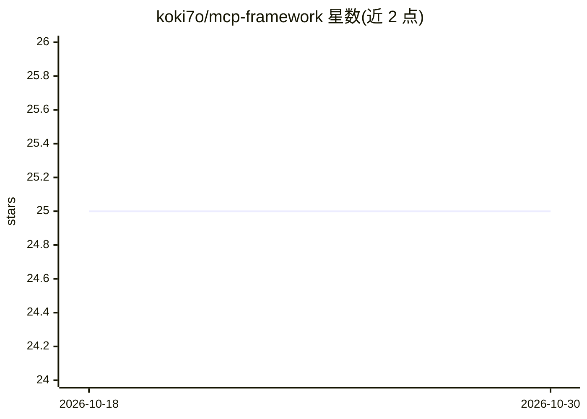

# koki7o/mcp-framework

⭐ 25 · Rust · MIT · 推送 2025-12-28 · [GitHub](https://github.com/koki7o/mcp-framework) · 个人维护

**构建 AI agent 的 Rust 框架，内置 MCP 客户端/服务器**

Rust 实现的 AI agent 开发框架：提供多 LLM 接入（Claude/Anthropic API 流式、OpenAI GPT-4/o1/o3 function calling）、MCP 客户端（HTTP 与 stdio 多服务器编排）、MCP 服务器（自定义工具注册）及 Web Inspector 调试 UI。基于 Tokio 异步运行时与官方 rmcp SDK，内置 Playwright MCP 浏览器自动化集成，附 7+ 示例。向量数据库、RAG、流式输出等在 Roadmap 中标记为 Planned。通过 git clone + cargo 运行，需 Rust 1.70+，agent 示例需 .env 中的 API key。

## 筛选速览

| 维度 | 判定 | 备注 |
|---|---|---|
| AI 角色 | `ai-ecosystem` | LLM/agent 周边工具 |
| 许可风险 | `permissive` | MIT |
| 部署形态 | `library` | 以包/库形式分发 |
| 模型依赖 | locked-api |  |
| 硬件要求 | — | 无带数字的原话,不猜 |
| 安装摩擦 | `low` | 无编译、无系统依赖或容器化 |
| 成熟度 | — | 结构信号不足 |

## 能力要点

- MCP 客户端多服务器编排（HTTP/stdio）与自定义 MCP 服务器构建
- Claude（流式）与 OpenAI（function calling）双 LLM 集成
- Web Inspector 可视化调试 MCP 工具（localhost:8123）
- 基于 Tokio 异步运行时与官方 rmcp SDK

## 适用场景

- 用 Rust 开发接入多个 MCP 服务器的生产级 AI agent
- 把内部 API 或数据库操作封装为 MCP 工具暴露
- 通过 Web Inspector 可视化测试 MCP 服务器工具
- 构建 AI 引导的浏览器自动化（抓取、表单、监控）

## 场景标签

`Agent 框架` · 领域:Agent 开发

## 证据(README 行号)

> L25: - **MCP Client**: Multi-server orchestration with HTTP and stdio transports
> L26: - **MCP Server**: Build custom tools and expose them via MCP protocol

## 星数曲线

2026-10-18 25 → 2026-10-30 25（+0）

---
*卡片 v1 · prompt 1.4 · 生成 2026-10-27 · 置信度 mid · 依据 README sha `dfb90c815342` · [字段定义](../../DATASET.md)*
