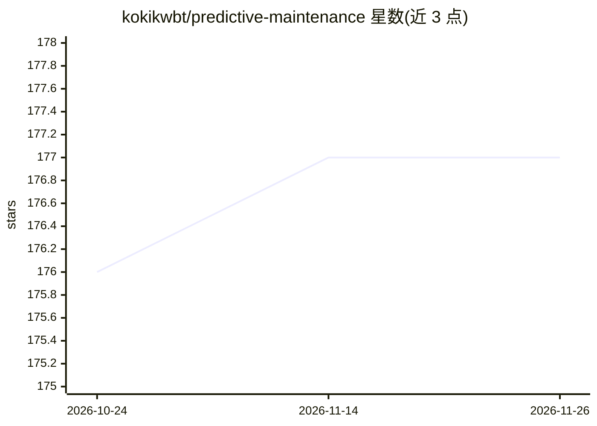

# kokikwbt/predictive-maintenance

⭐ 177 · Jupyter Notebook · MIT · 推送 2026-11-10 · [GitHub](https://github.com/kokikwbt/predictive-maintenance) · 个人维护

**预测性维护研究数据集的下载/加载/可视化工具包**

面向预测性维护研究的 Python 工具包：通过统一 API 与各数据集专属加载器，下载、加载并可视化维护类数据集，支持按需下载（如 cmapss，直连 URL 无需 Kaggle 登录）。加载结果为 Polars DataFrame/LazyFrame。安装基于 uv 与锁定 Python 3.14 环境，注册 Jupyter 内核；下载 IMS 数据集需可选的系统 libarchive。代码与文档采用 MIT 许可，数据使用条款另见各数据集 README。

## 筛选速览

| 维度 | 判定 | 备注 |
|---|---|---|
| AI 角色 | `ai-knowledge` | 知识聚合/清单类 |
| 许可风险 | `permissive` | MIT |
| 部署形态 | `None` |  |
| 模型依赖 | — | README 未给出锁定关系 |
| 硬件要求 | — | 无带数字的原话,不猜 |
| 安装摩擦 | `low` | 无编译、无系统依赖或容器化 |
| 成熟度 | — | 结构信号不足 |

## 能力要点

- 统一 API 的数据集下载/加载/可视化，按需下载
- cmapss 等数据集直连 URL 下载，无需 Kaggle 登录
- 加载器返回 Polars DataFrame/LazyFrame
- uv 锁定环境与 Jupyter 内核一键配置

## 适用场景

- 为 PHM/预测性维护研究获取公开基准数据集
- 在 Jupyter 中浏览传感器轨迹等数据并做实验
- 按任务列表查找数据集与评分协议

## 场景标签

 · 领域:工业/科研数据集工具

## 证据(README 行号)

> L1: # PdMData: Datasets for Predictive Maintenance
> L6: A Python toolkit to download, load, and visualize predictive-maintenance
> L7: datasets for research. Use a shared API with dataset-specific loaders; download

## 星数曲线

2026-10-24 176 → 2026-11-26 177（+1）

---
*卡片 v1 · prompt 1.4 · 生成 2026-11-26 · 置信度 high · 依据 README sha `9d580e12eb1c` · [字段定义](../../DATASET.md)*
