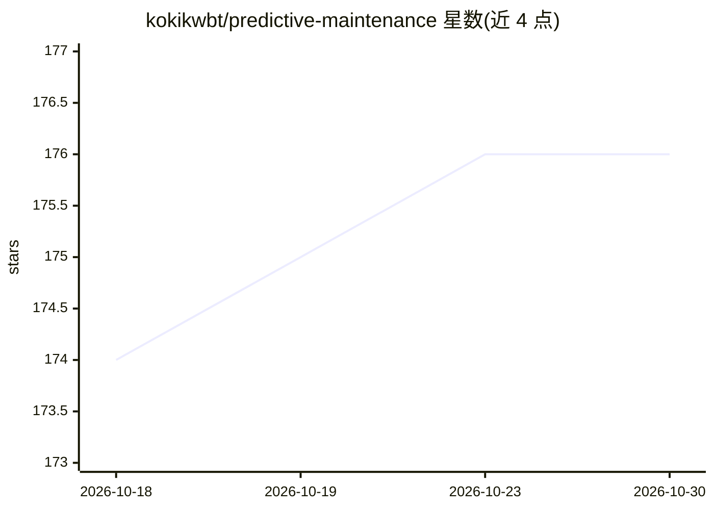

# kokikwbt/predictive-maintenance

⭐ 176 · Jupyter Notebook · MIT · 推送 2026-10-24 · [GitHub](https://github.com/kokikwbt/predictive-maintenance) · 个人维护

**预测性维护数据集的下载加载可视化 Python 工具包**

面向研究的 Python 工具包：提供统一 API 下载、加载与可视化预测性维护数据集（如 C-MAPSS），按数据集专属 loader 处理，按需下载、不做整包拉取。返回 Polars DataFrame/LazyFrame，带 Jupyter 内核注册与可视化函数。使用 uv 管理，要求 Python 3.14，自动创建锁定环境；IMS 数据集需要系统 libarchive 库（可选）。代码以 MIT 许可发布，各数据集有各自的使用条款。

## 筛选速览

| 维度 | 判定 | 备注 |
|---|---|---|
| AI 角色 | `ai-knowledge` | 知识聚合/清单类 |
| 许可风险 | `permissive` | MIT |
| 部署形态 | `None` |  |
| 模型依赖 | — | README 未给出锁定关系 |
| 硬件要求 | — | 无带数字的原话,不猜 |
| 安装摩擦 | `low` | 无编译、无系统依赖或容器化 |
| 成熟度 | — | 结构信号不足 |

## 能力要点

- 统一 API 的数据集专属 loader，按需下载
- 返回 Polars DataFrame/LazyFrame
- C-MAPSS 等数据集直接 URL 下载，无需 Kaggle 登录
- 内置 sensor_trajectory 等可视化函数

## 适用场景

- 为预测性维护研究快速获取标准数据集
- 在 JupyterLab 中浏览与可视化传感器退化数据
- 按官方评分协议运行实验任务

## 场景标签

`科研工具` · 领域:学习与行业

## 证据(README 行号)

> L1: # PdMData: Datasets for Predictive Maintenance
> L3: A Python toolkit to download, load, and visualize predictive-maintenance
> L4: datasets for research. Use a shared API with dataset-specific loaders; download

## 星数曲线

2026-10-18 174 → 2026-10-30 176（+2）

---
*卡片 v1 · prompt 1.4 · 生成 2026-10-22 · 置信度 high · 依据 README sha `dabe3ee4f790` · [字段定义](../../DATASET.md)*
