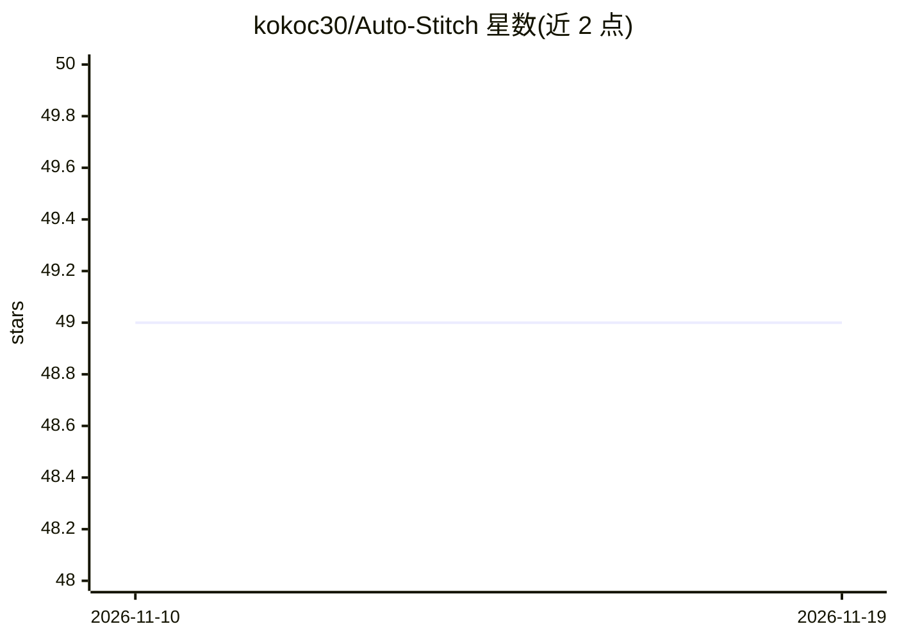

# kokoc30/Auto-Stitch

⭐ 49 · 推送 2026-11-07 · [GitHub](https://github.com/kokoc30/Auto-Stitch) · [官网](https://autostitch.app) · 个人维护

**面向创作者的 AI 剪辑平台：长视频转竖版短视频（产品展示）**

Auto Stitch 是一个专有（proprietary）AI 辅助视频剪辑应用，将长视频转换为竖版短视频，集成片段发现、构图、字幕与剪辑流程。功能包括 AI 片段发现与选择、自动竖版重构与智能变焦、自动字幕、手动拼接与重排、预览下载，以及 YouTube 发布排期。通过 autostitch.app 网页使用，创建片段需账号。本仓库仅为公开产品展示，不含源码、AI 处理管线与基础设施。

## 筛选速览

| 维度 | 判定 | 备注 |
|---|---|---|
| AI 角色 | `ai-native` | 本体是模型或模型工具 |
| 许可风险 | `none` | — |
| 部署形态 | `None` |  |
| 模型依赖 | — | README 未给出锁定关系 |
| 硬件要求 | — | 无带数字的原话,不猜 |
| 安装摩擦 | `low` | 无编译、无系统依赖或容器化 |
| 成熟度 | `idea` | |

## 能力要点

- AI 辅助片段发现与选择
- 自动竖版重构与智能变焦、自动字幕
- 支持 YouTube 发布与排期
- 以链接或上传文件输入，面向 Shorts/Reels/TikTok 输出

## 适用场景

- 把长视频快速裁成 YouTube Shorts/Reels/TikTok 竖版片段
- 减少筛选素材时间，专注审核编辑结果
- 在站内完成剪辑到发布排期的流程

## 场景标签

`图像视频处理` · 领域:感知与多模态

## 证据(README 行号)

> L5: Auto Stitch is a proprietary AI-assisted video-editing application that turns long-form videos into short, vertical 
> L23: - AI-assisted clip discovery and selection.

## 星数曲线

2026-11-10 49 → 2026-11-19 49（+0）

---
*卡片 v1 · prompt 1.4 · 生成 2026-11-18 · 置信度 high · 依据 README sha `06db7ce36e38` · [字段定义](../../DATASET.md)*
