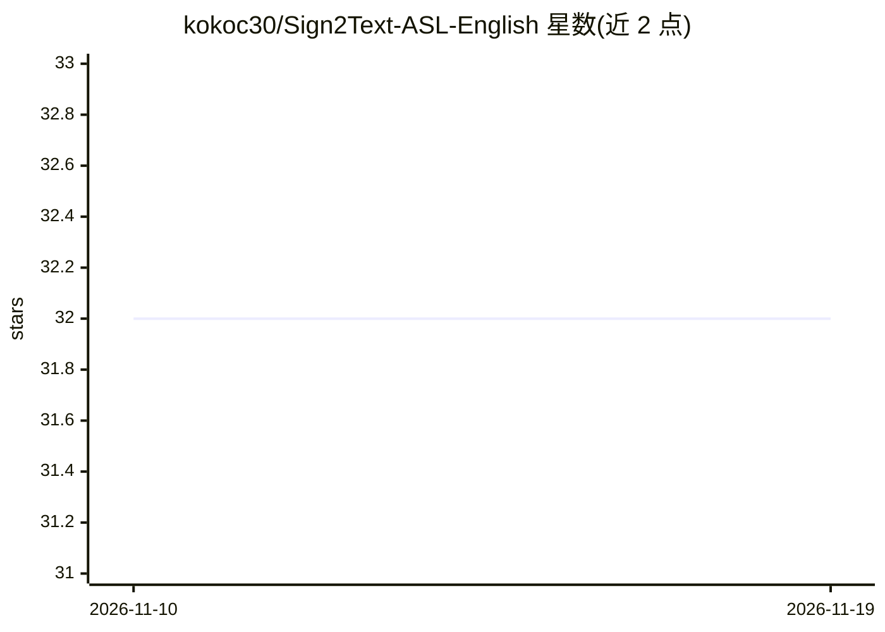

# kokoc30/Sign2Text-ASL-English

⭐ 32 · Python · NOASSERTION · 推送 2026-11-10 · [GitHub](https://github.com/kokoc30/Sign2Text-ASL-English) · [官网](https://www.linkedin.com/in/koko-jamgotchian09/) · 个人维护

**给听障与非手语使用者的实时手语转英语字幕 Web 应用**

浏览器端 Web 应用：用普通摄像头做美式手语（ASL）整词识别——姿态估计出 86 个全身关键点，速度法切分符号边界，CTR-GCN + Conformer 分类出 gloss，再由本地或远程语言模型改写成自然英语句子；另含语音转文字（供听人一方）、拼指语识别、会话记录管理与后台面板。后端为 5 个 FastAPI 服务，由 start.py 统一启动，CUDA/CPU 自适应。限制：作品集性质仓库，部分模型权重、私有数据与生产凭据未包含，非完整生产部署。

## 筛选速览

| 维度 | 判定 | 备注 |
|---|---|---|
| AI 角色 | `ai-native` | 本体是模型或模型工具 |
| 许可风险 | `none` | NOASSERTION |
| 部署形态 | `library` | 以包/库形式分发 |
| 模型依赖 | local-ok | 支持本地模型 |
| 硬件要求 | — | 无带数字的原话,不猜 |
| 安装摩擦 | `medium` | 含编译或系统依赖之一 |
| 成熟度 | `idea` | |

## 能力要点

- 整词级手语识别流水线：姿态→切分→CTR-GCN 分类→语言模型转英语
- 拼指语识别（MediaPipe + MLP，字母累积与词边界检测）
- 语音转文字与翻译/合成，实现单屏双向对话
- CUDA/CPU 自适应运行时，无 GPU 也可运行

## 适用场景

- 听障用户与不识手语的人在同一屏幕上对话
- 实时将 ASL 手语转为可读英文字幕
- 在普通笔记本摄像头和一般光照条件下使用

## 场景标签

`语音识别` · 领域:感知与多模态

## 证据(README 行号)

> L3: Sign2Text is a web application that turns American Sign Language into readable
> L71: |**ASL**|Browser camera|Pose estimation → sign-boundary segmentation → CTR-GCN classification → gloss buffering → l
> L141: |**External services**|Google Speech-to-Text, Google Text-to-Speech, Azure Translator, Ollama|

## 星数曲线

2026-11-10 32 → 2026-11-19 32（+0）

---
*卡片 v1 · prompt 1.4 · 生成 2026-11-18 · 置信度 mid · 依据 README sha `cf23fbab3ecc` · [字段定义](../../DATASET.md)*
