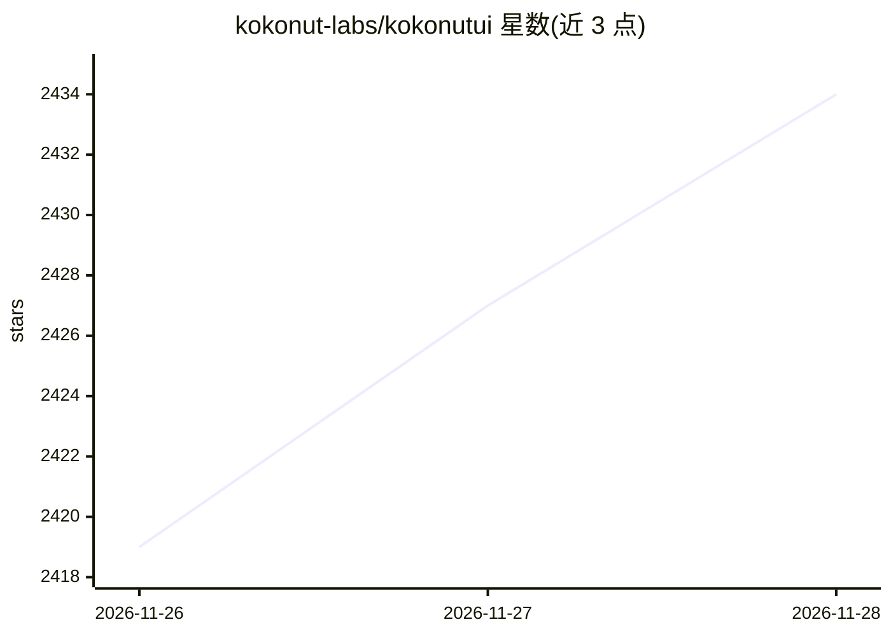

# kokonut-labs/kokonutui

⭐ 2,434 · TypeScript · MIT · 推送 2026-11-27 · [GitHub](https://github.com/kokonut-labs/kokonutui) · [官网](https://kokonutui.com) · 组织维护

**面向 AI 聊天与 Agent 界面的开源 React 组件库**

100+ 个基于 Tailwind CSS、Motion 与 shadcn/ui 构建的 React 组件，覆盖 AI 场景（Tool Calls、Tool Approval、Model Selector、Inline Citations、Voice）以及周边的按钮、卡片、输入、导航、文本动效等类别。以 shadcn/ui registry 形式分发，通过 shadcn CLI 将源码写入用户代码库，用户拥有组件代码；每个组件提供在线演示、源码与依赖说明。另含 Pro 付费层提供组件、blocks 与 Next.js 模板，安装通道相同。

## 筛选速览

| 维度 | 判定 | 备注 |
|---|---|---|
| AI 角色 | `ai-ecosystem` | LLM/agent 周边工具 |
| 许可风险 | `permissive` | MIT |
| 部署形态 | `library` | 以包/库形式分发 |
| 模型依赖 | — | README 未给出锁定关系 |
| 硬件要求 | — | 无带数字的原话,不猜 |
| 安装摩擦 | `low` | 无编译、无系统依赖或容器化 |
| 成熟度 | — | 结构信号不足 |

## 能力要点

- 100+ 组件基于 Tailwind CSS、Motion 与 shadcn/ui 构建
- 通过 shadcn CLI 或 MCP 由 agent 安装，源码写入用户代码库
- AI 类组件含 Tool Calls、Tool Approval、Model Selector、Voice 等
- 每个组件附在线演示、源码与依赖清单

## 适用场景

- 为 AI 聊天应用搭建工具调用与审批交互界面
- 在 React/Next.js 项目中快速添加对话相关 UI 组件
- 让 Claude Code/Cursor 等 agent 通过 MCP 搜索并安装组件

## 场景标签

 · 领域:前端开发/UI组件库

## 证据(README 行号)

> L7:  Open-source React components for AI chat and agents, and the inputs, cards and buttons around them.
> L8:  100+ components built with Tailwind CSS, Motion and shadcn/ui. Your agent or the shadcn CLI installs them, and they
> L67: Claude Code, Cursor, VS Code and Codex can search and install Kokonut UI components through the shadcn MCP server. 

## 星数曲线

2026-11-26 2,419 → 2026-11-28 2,434（+15）

---
*卡片 v1 · prompt 1.4 · 生成 2026-11-26 · 置信度 high · 依据 README sha `ab1866e81c39` · [字段定义](../../DATASET.md)*
