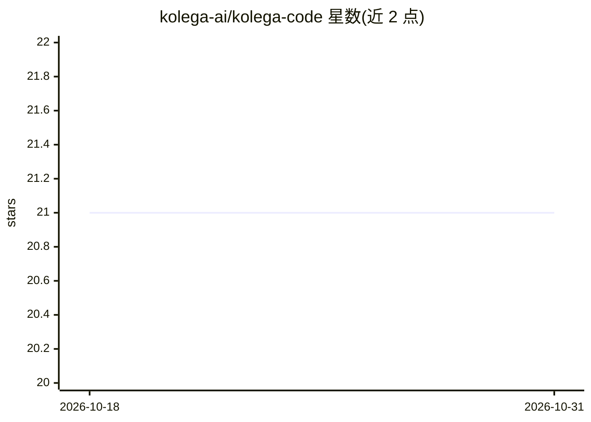

# kolega-ai/kolega-code

⭐ 21 · Python · NOASSERTION · 推送 2026-10-30 · [GitHub](https://github.com/kolega-ai/kolega-code) · [官网](https://kolega-ai.github.io/kolega-code/) · 组织维护

**本地优先的终端编程 agent，模型自写多智能体编排（Gigacode）**

Python 编写的终端编程 agent，面向开发者。核心机制 Gigacode：模型针对仓库级宽任务编写 Python 编排程序（agent/parallel/pipeline/phase/budget API），运行时执行并落盘脚本与日志，支持内容键控断点续跑（未变更调用零 token 重放）；运行时强制并发上限、agent 数与 token 预算。另提供 Plan/Build 模式、仓库工具、shell 执行、Playwright 浏览器 agent、MCP 接入、Textual TUI 与一次性 CLI、Zed/VS Code 的 ACP 集成。支持 15+ 模型提供商含本地 Llama，本地优先存储会话与密钥。Gigacode 默认关闭，需 Python 3.11+ 与至少一个模型来源。

## 筛选速览

| 维度 | 判定 | 备注 |
|---|---|---|
| AI 角色 | `ai-native` | 本体是模型或模型工具 |
| 许可风险 | `none` | NOASSERTION |
| 部署形态 | `library` | 以包/库形式分发 |
| 模型依赖 | local-ok | 支持本地模型 |
| 硬件要求 | — | 无带数字的原话,不猜 |
| 安装摩擦 | `low` | 无编译、无系统依赖或容器化 |
| 成熟度 | — | 结构信号不足 |

## 能力要点

- Gigacode：模型编写 Python 程序编排并行子 agent、流水线、对抗校验与评审面板
- 运行时日志落盘，内容键控 resume 使未变更调用零 token 重放，跨会话/重启可用
- 支持 MCP 服务器（streamable_http/sse/stdio，含 OAuth）作为权限受控工具
- 按角色路由模型（主循环/工具调用/思考可各用不同模型），工作流内可 model_override

## 适用场景

- 日常终端内的代码调查、编辑与实现（Plan/Build 模式）
- 仓库级重构、迁移、多工作流任务由模型自写编排程序并行执行
- 在 Zed/VS Code 中经 Agent Client Protocol 驱动同一 agent
- 用 kolega-code ask 做脚本化/CI 中的自动化提问

## 场景标签

`编码 Agent` `多智能体` · 领域:Agent 开发

## 证据(README 行号)

> L3: **A terminal coding agent where the model writes its own multi-agent workflows.**
> L13: for one agent loop, its **Gigacode** engine has the model write a Python program

## 星数曲线

2026-10-18 21 → 2026-10-31 21（+0）

---
*卡片 v1 · prompt 1.4 · 生成 2026-10-28 · 置信度 high · 依据 README sha `670c240f55d6` · [字段定义](../../DATASET.md)*
