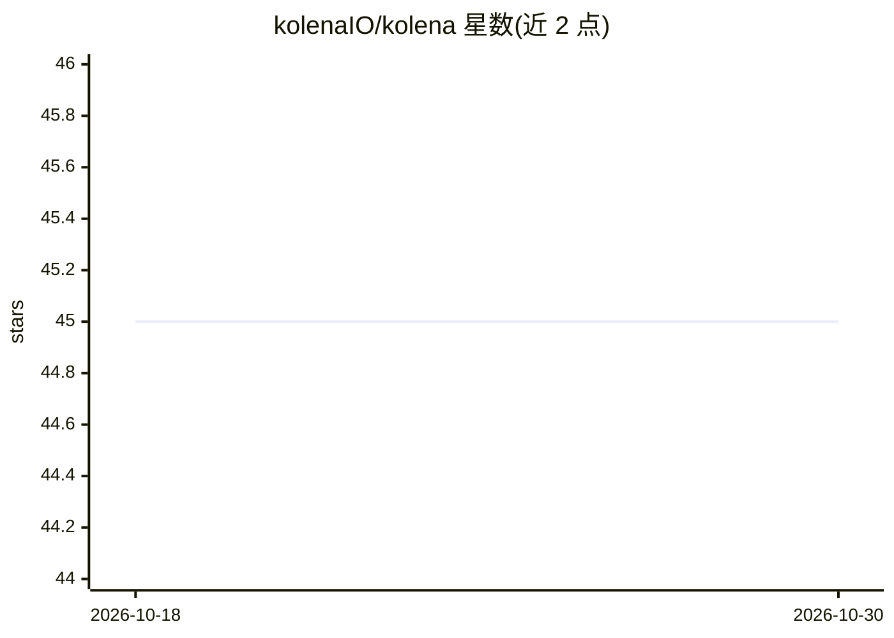

# kolenaIO/kolena

⭐ 45 · Python · Apache-2.0 · 推送 2026-07-17 · [GitHub](https://github.com/kolenaIO/kolena) · [官网](https://docs.kolena.io) · 组织维护

**Kolena 机器学习测试平台的 Python 客户端库**

kolena 是 kolenaIO 维护的 Python 客户端库，用于以编程方式接入 Kolena 机器学习测试与调试平台。平台功能包括高分辨率模型评估、跟踪行为改进与回归、沟通模型能力、自动化模型测试与部署流程。客户端库通过 pip 安装后即可与平台交互，配套开发者指南、快速上手、API 参考与不同机器学习工作流的参考集成示例。需配合 Kolena 平台使用，采用 Apache-2.0 许可。

## 筛选速览

| 维度 | 判定 | 备注 |
|---|---|---|
| AI 角色 | `ai-ecosystem` | LLM/agent 周边工具 |
| 许可风险 | `permissive` | Apache-2.0 |
| 部署形态 | `library` | 以包/库形式分发 |
| 模型依赖 | — | README 未给出锁定关系 |
| 硬件要求 | — | 无带数字的原话,不猜 |
| 安装摩擦 | `low` | 无编译、无系统依赖或容器化 |
| 成熟度 | — | 结构信号不足 |

## 能力要点

- 以编程方式与 Kolena ML 测试平台交互的 Python 客户端
- 支持模型评估、回归跟踪与自动化测试工作流
- 提供不同机器学习工作流的参考集成示例

## 适用场景

- 在 Python 工作流中程序化执行模型测试与评估
- 跟踪模型行为改进与回归
- 将模型测试接入自动化部署流程

## 场景标签

`模型评测` `MLOps` · 领域:评测与运维

## 证据(README 行号)

> L26: Kolena is a comprehensive machine learning testing and debugging platform to surface hidden
> L34: This `kolena` package contains the Python client library for programmatic interaction with the Kolena ML testing

## 星数曲线

2026-10-18 45 → 2026-10-30 45（+0）

---
*卡片 v1 · prompt 1.4 · 生成 2026-10-25 · 置信度 high · 依据 README sha `298725538abb` · [字段定义](../../DATASET.md)*
