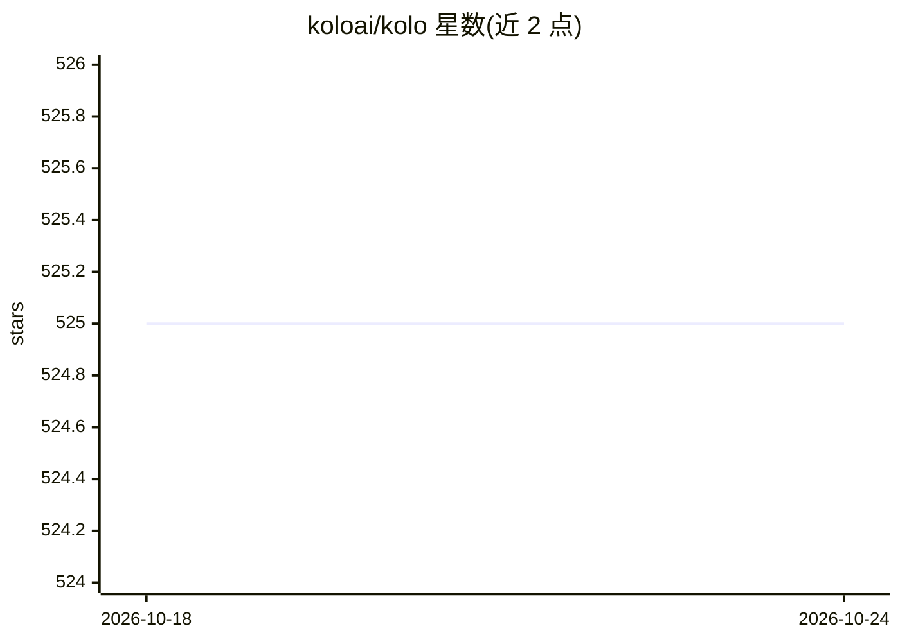

# koloai/kolo

⭐ 525 · 推送 2026-04-17 · [GitHub](https://github.com/koloai/kolo) · [官网](https://kolo.app) · 组织维护

**面向 AI agent 开发的 Python 追踪调试器**

Kolo 是一个基于文本的 Python 调试工具，用于追踪并可视化代码执行过程：捕获函数调用、返回值、局部变量、HTTP 请求等，写入可供人类与 agent 检索的纯文本 trace 文件。v3 将追踪数据以纯文本文件形式存储。主要面向使用 Django 等 Python 框架的开发者，通过 pip 安装并添加中间件即可在本地页面浏览追踪请求，查看 trace、SQL 查询与函数调用。提供文档站点与 Discord 社区。

## 筛选速览

| 维度 | 判定 | 备注 |
|---|---|---|
| AI 角色 | `ai-ecosystem` | LLM/agent 周边工具 |
| 许可风险 | `none` | — |
| 部署形态 | `library` | 以包/库形式分发 |
| 模型依赖 | — | README 未给出锁定关系 |
| 硬件要求 | — | 无带数字的原话,不猜 |
| 安装摩擦 | `low` | 无编译、无系统依赖或容器化 |
| 成熟度 | — | 结构信号不足 |

## 能力要点

- 捕获函数调用、返回值、局部变量与 HTTP 请求
- trace 数据以纯文本文件存储，可供 grep 检索
- 提供 Django 中间件，在 localhost:8000/_kolo/ 浏览追踪请求
- 支持查看 SQL 查询与函数调用详情

## 适用场景

- 调试 Django 请求的执行流程与 SQL 查询
- 为 AI agent 提供可检索的代码执行 trace 文件
- 可视化分析真实应用中的函数调用链

## 场景标签

`LLM 可观测性` · 领域:评测与运维

## 证据(README 行号)

> L1: # Kolo
> L7: Trace and visualize your Python code.

## 星数曲线

2026-10-18 525 → 2026-10-24 525（+0）

---
*卡片 v1 · prompt 1.4 · 生成 2026-10-21 · 置信度 mid · 依据 README sha `9c73157fdcd1` · [字段定义](../../DATASET.md)*
