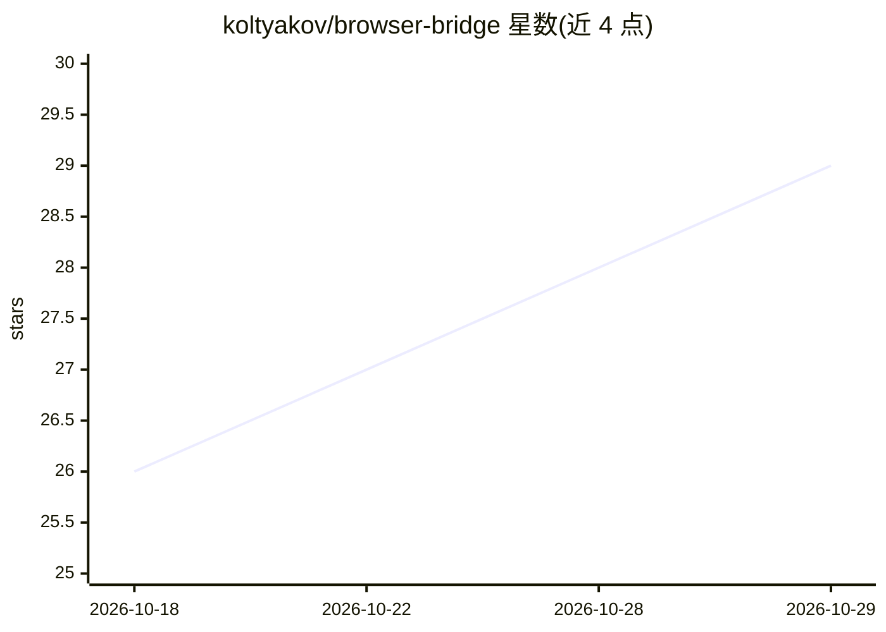

# koltyakov/browser-bridge

⭐ 29 · TypeScript · MIT · 推送 2026-10-28 · [GitHub](https://github.com/koltyakov/browser-bridge) · 个人维护

**让编码 Agent 检查/操控真实 Chrome 标签页的本地浏览器桥**

由 Chrome 扩展、原生宿主守护进程与 CLI/MCP 接口组成：将已打开的真实标签页（含登录态、SPA 状态）的结构化 DOM、样式、布局、控制台、网络与无障碍数据暴露给编码 Agent，支持可靠输入、对话框处理、可回滚页面补丁、脱敏 HAR 导出、录屏与文件工作流。支持 OpenAI Codex、Claude Code、Cursor、Copilot 等多种 Agent 的 MCP/CLI 技能安装。作用域限定单个显式启用的浏览器窗口，本地优先，无自有云服务。

## 筛选速览

| 维度 | 判定 | 备注 |
|---|---|---|
| AI 角色 | `ai-ecosystem` | LLM/agent 周边工具 |
| 许可风险 | `permissive` | MIT |
| 部署形态 | `library` | 以包/库形式分发 |
| 模型依赖 | — | README 未给出锁定关系 |
| 硬件要求 | — | 无带数字的原话,不猜 |
| 安装摩擦 | `low` | 无编译、无系统依赖或容器化 |
| 成熟度 | — | 结构信号不足 |

## 能力要点

- 从已打开标签页读取结构化 DOM/样式/布局/控制台/网络/无障碍数据
- 支持 MCP 与 CLI 技能两种接入方式，兼容 8 类编码 Agent
- 可回滚的实时页面补丁与脱敏（不含 headers/cookies/授权值）HAR 1.2 导出
- 作用域限定单个显式启用窗口，扩展与原生宿主在本机通信

## 适用场景

- 在 localhost 调试 UI 时让 Agent 直接读取真实 DOM 与控制台/网络状态
- 验证代码改动在 Chrome 中的实际渲染结果并就地试验补丁
- 为不同 IDE/Agent 统一提供浏览器检查与操控能力

## 场景标签

`浏览器自动化` · 领域:效率与自动化

## 证据(README 行号)

> L7: A local bridge between your coding agent and a real Chrome tab. Browser Bridge gives the agent structured access to 
> L13: Managed installs support OpenAI Codex, Claude Code, Cursor, GitHub Copilot, OpenCode, Antigravity, Windsurf, and ge
> L87: 2. `npm install -g @browserbridge/bbx` - installs the CLI and native host

## 星数曲线

2026-10-18 26 → 2026-10-29 29（+3）

---
*卡片 v1 · prompt 1.4 · 生成 2026-10-26 · 置信度 high · 依据 README sha `d42e6fe56e25` · [字段定义](../../DATASET.md)*
