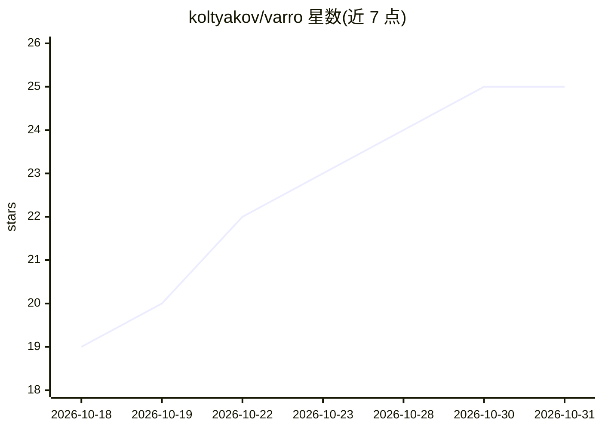

# koltyakov/varro

⭐ 25 · TypeScript · MIT · 推送 2026-10-30 · [GitHub](https://github.com/koltyakov/varro) · [官网](https://marketplace.visualstudio.com/items?itemName=koltyakov.varro) · 个人维护

**在 VS Code 内运行 OpenCode 的编码 agent 工作台扩展**

VS Code/VSCodium 扩展，将 OpenCode CLI 嵌入编辑器并提供图形界面：项目感知聊天、并行会话与队列、计划与 diff 审查、按会话的权限模式、提交信息生成与跨项目用量统计。Agent、模型、provider、技能与 MCP 服务器均由 OpenCode 配置并管理，Varro 读取该配置并渲染 UI。要求 VS Code 1.107+、Node.js 22/24 指定版本与 OpenCode v2（推荐）或 v1 CLI。桌面通知与听写功能要求本地桌面环境，不适用于 SSH/WSL/容器；移动伴侣 PWA 处于邀请制实验阶段。

## 筛选速览

| 维度 | 判定 | 备注 |
|---|---|---|
| AI 角色 | `ai-ecosystem` | LLM/agent 周边工具 |
| 许可风险 | `permissive` | MIT |
| 部署形态 | `library` | 以包/库形式分发 |
| 模型依赖 | — | README 未给出锁定关系 |
| 硬件要求 | — | 无带数字的原话,不猜 |
| 安装摩擦 | `medium` | 含编译或系统依赖之一 |
| 成熟度 | `idea` | |

## 能力要点

- 并行会话运行、队列与中途干预
- 按会话权限模式（Default/Auto/Full access）与计划、diff 审查
- 基于暂存变更生成提交信息，不自动提交
- /stats 跨项目 token 与时长用量报告，含 provider 配额窗口

## 适用场景

- 在 VS Code 里以图形界面使用 OpenCode 的编码 agent
- 同时跑多个 agent 会话并排队后续任务
- 审查 agent 的计划、diff 与权限请求后再放行

## 场景标签

`编码 Agent` · 领域:编码与开发

## 证据(README 行号)

> L9: Varro runs OpenCode inside VS Code. It adds project-aware chat, parallel sessions, plan and change review, model and
> L13: OpenCode remains responsible for agents, providers, models, commands, skills, MCP servers, and their configuration.

## 星数曲线

2026-10-18 19 → 2026-10-31 25（+6）

---
*卡片 v1 · prompt 1.4 · 生成 2026-10-27 · 置信度 mid · 依据 README sha `3b125e7b5b51` · [字段定义](../../DATASET.md)*
