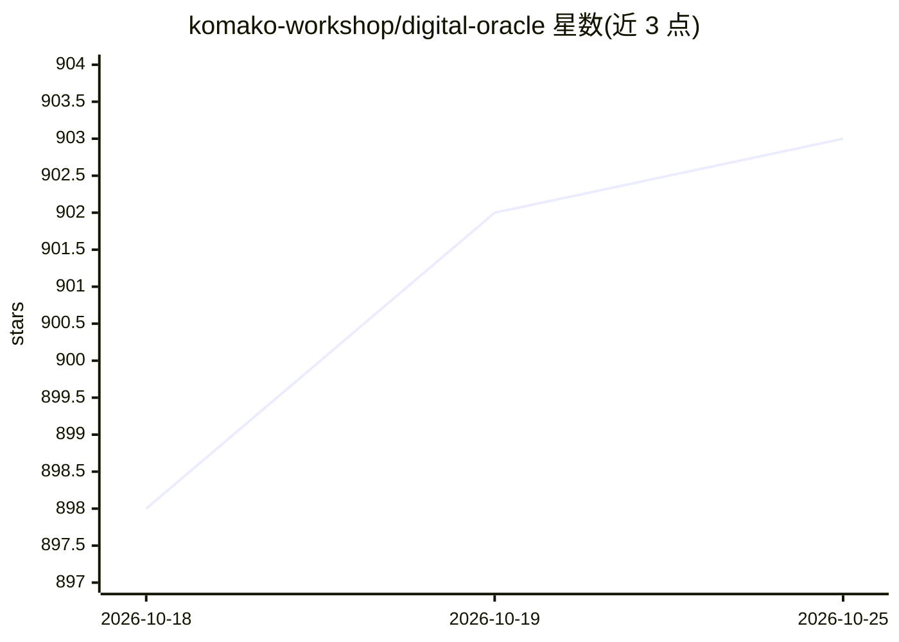

# komako-workshop/digital-oracle

⭐ 903 · Python · MIT · 推送 2026-07-26 · [GitHub](https://github.com/komako-workshop/digital-oracle) · 组织维护 · 中文 README

**AI Agent 技能：从金融数据挖掘宏观事件的概率估计**

面向 OpenClaw / Claude Code / Cursor / Codex 的 agent skill：接入 Polymarket、Kalshi、美国国债收益率、CFTC 持仓、SEC 内部人交易、央行利率、加密衍生品及 A 股资金流等 13 个金融数据源，不读新闻文章，仅从交易数据中挖掘信号，回答房价、黄金、比特币、地缘冲突等宏观问题，输出结构化概率估计与推理链。所有 API 免费、无需 Key；12/13 个 provider 仅用 Python 标准库，通过 clawhub install 或让 agent 自行 clone 并读取 SKILL.md 安装。

## 筛选速览

| 维度 | 判定 | 备注 |
|---|---|---|
| AI 角色 | `ai-native` | 本体是模型或模型工具 |
| 许可风险 | `permissive` | MIT |
| 部署形态 | `library` | 以包/库形式分发 |
| 模型依赖 | — | README 未给出锁定关系 |
| 硬件要求 | — | 无带数字的原话,不猜 |
| 安装摩擦 | `low` | 无编译、无系统依赖或容器化 |
| 成熟度 | — | 结构信号不足 |

## 能力要点

- 接入 13 个免费无 Key 的金融数据源（Polymarket/Kalshi/CFTC/SEC 等）
- 输出结构化概率估计与多层信号表格、场景分析
- 12/13 provider 零外部依赖（纯 Python 标准库）
- 支持部分失败容忍与快照测试（CI 无网络可跑）

## 适用场景

- 让编程 agent 基于交易数据回答宏观趋势问题
- 获取房价、黄金、比特币等事件的市场定价概率估计
- 在 Claude Code / Cursor / Codex 中作为金融分析技能调用

## 场景标签

`金融量化` · 领域:学习与行业

## 证据(README 行号)

> L5: Digital Oracle 是一款让 AI Agent 基于从海量金融数据中，挖掘出宏观事件发展趋势的开源 Skill。
> L19: 它不看报纸不读新闻，不消费文章、短视频、播客，只通过从金融数据中挖掘出的价值信号，来回答房价涨跌、黄金走势、比特币周期、军事冲突概率这类问题，并给出结构化的概率估计和推理链。
> L32: 只要有市场在定价这件事，Digital Oracle 就能给出一个基于交易数据的概率估计。

## 星数曲线

2026-10-18 898 → 2026-10-25 903（+5）

---
*卡片 v1 · prompt 1.4 · 生成 2026-10-21 · 置信度 mid · 依据 README sha `006779b68a37` · [字段定义](../../DATASET.md)*
