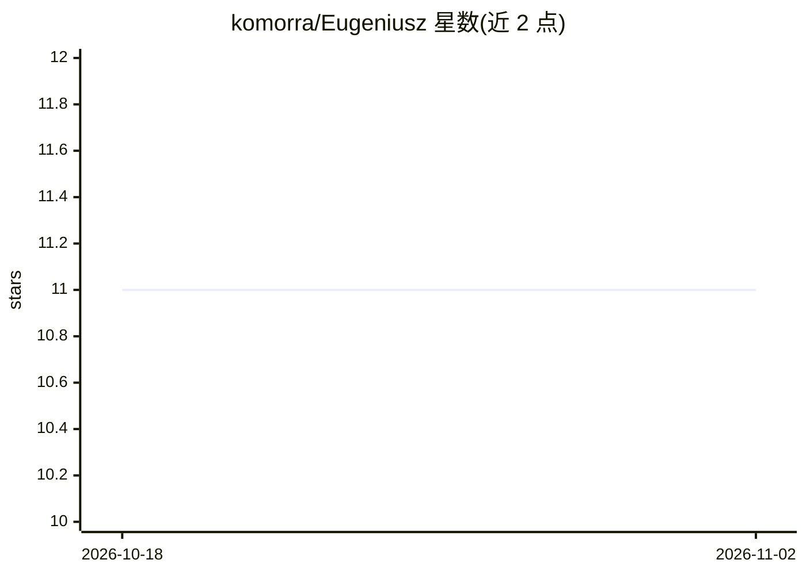

# komorra/Eugeniusz

⭐ 11 · Python · MIT · 推送 2026-09-17 · [GitHub](https://github.com/komorra/Eugeniusz) · 个人维护

**面向 C++/C#/Python/游戏引擎的本地类型化 AI 决策库**

MIT 许可的 C++17 库，带版本化 C ABI：把文本对问题求值，返回选择题、量表评分或真/假概率三类结构化结果，推理在本进程内完成，无需服务器、API key 或解析生成 JSON。通过 llama.cpp 运行 Qwen2/Qwen3、SmolLM2 的 GGUF 模型，提供 light/medium/large 三档发布配置（权重 639MB–2,497MB），CPU/Vulkan/CUDA/Metal 后端。作者声明其为 Jev/TypeSafe AI 决策接口的独立实验性替代，不复制其专有架构与精度；小模型在数值与逻辑推理上偏弱，高置信度不等于正确。附 Python(ctypes)、.NET Standard 2.1 封装、Unity 6.6 与 Unreal 5.8 示例及四个 WinForms 示例。

## 筛选速览

| 维度 | 判定 | 备注 |
|---|---|---|
| AI 角色 | `ai-native` | 本体是模型或模型工具 |
| 许可风险 | `permissive` | MIT |
| 部署形态 | `desktop` | 安装包/桌面程序 |
| 模型依赖 | local-ok | 支持本地模型 |
| 硬件要求 | `gpu-8g` | |
| 安装摩擦 | `high` | 编译与系统依赖俱全 |
| 成熟度 | `idea` | |

## 能力要点

- Choice/Score/Truth 三种类型化输出，无需生成 token 或输出解析器
- 进程内本地推理，无服务器与 API key
- 三档模型配置，同一 C ABI，支持 CPU/Vulkan/CUDA/Metal
- Python、.NET、Unity、Unreal 绑定与示例，含温度拟合与 NLL/Brier/ECE 校准指标

## 适用场景

- 在 C++/C#/Python 应用或 Unity/Unreal 游戏内做本地路由、动作选择或布尔判断
- 对文本按自定义量表评分（严重度、情感、质量等级）
- 离线环境下为游戏 NPC 或传感器决策提供低延迟模型推理

## 场景标签

`推理引擎` · 领域:训练与推理

## 证据(README 行号)

> L18: Eugeniusz is an MIT-licensed C++17 library with a versioned C ABI. It evaluates text
> L19: against a question and returns a choice, a rubric score, or a truth probability.
> L20: There is no server, API key, Python runtime requirement for native applications,

## 星数曲线

2026-10-18 11 → 2026-11-02 11（+0）

---
*卡片 v1 · prompt 1.4 · 生成 2026-11-02 · 置信度 high · 依据 README sha `0f9c172a2707` · [字段定义](../../DATASET.md)*
