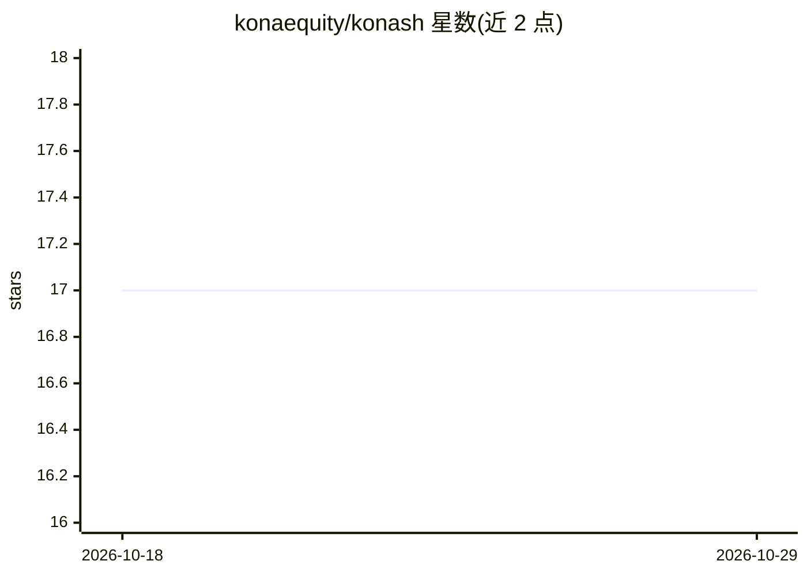

# konaequity/konash

⭐ 17 · Python · 推送 2026-03-23 · [GitHub](https://github.com/konaequity/konash) · [官网](https://pypi.org/project/konash/) · 组织维护

**用强化学习训练知识检索 agent 的开源训练框架**

基于 KARL（Databricks）与 OAPL 算法实现的训练框架：指向任意文档语料，通过语料嵌入索引、agent 式 QA 合成、多步搜索 rollout、通过率过滤与离策略 RL，训练模型的搜索与推理策略。提供 CLI（konash setup/train/eval）与 Python API，云端 GPU 经 Shadeform 供给，本地训练需 torch+transformers+peft，部署支持 vLLM 与 LoRA 热切换。训练推荐 GLM 4.5 Air（1x H200），支持 FinanceBench、QAMPARI 等数据集。

## 筛选速览

| 维度 | 判定 | 备注 |
|---|---|---|
| AI 角色 | `ai-ecosystem` | LLM/agent 周边工具 |
| 许可风险 | `none` | — |
| 部署形态 | `library` | 以包/库形式分发 |
| 模型依赖 | — | README 未给出锁定关系 |
| 硬件要求 | — | 无带数字的原话,不猜 |
| 安装摩擦 | `low` | 无编译、无系统依赖或容器化 |
| 成熟度 | — | 结构信号不足 |

## 能力要点

- 语料→QA 合成→rollout→过滤→OAPL 训练的完整流水线
- Shadeform 云 GPU 供给，训练规模约 1 小时至数小时
- 预置 Qwen3 嵌入索引的 4 个数据集与本地文件夹支持
- 学习型价值模型引导测试时树搜索，N=10-20 并行 rollout 聚合

## 适用场景

- 在我自己的文档语料上训练会搜索、会多步推理的模型
- 复现 KARL 论文在 FinanceBench 上的 RL 训练结果
- 对比不同模型的检索问答表现（Arena）

## 场景标签

`强化学习` `RAG` · 领域:知识与检索

## 证据(README 行号)

> L38: 5. **OAPL training** — Off-policy RL with squared advantage loss trains the model on successful search strategies
> L70: Standard retrieval systems use a frozen model with a single retrieve-then-read pass. KONASH trains the model's **se

## 星数曲线

2026-10-18 17 → 2026-10-29 17（+0）

---
*卡片 v1 · prompt 1.4 · 生成 2026-10-29 · 置信度 high · 依据 README sha `b67bdd85816b` · [字段定义](../../DATASET.md)*
