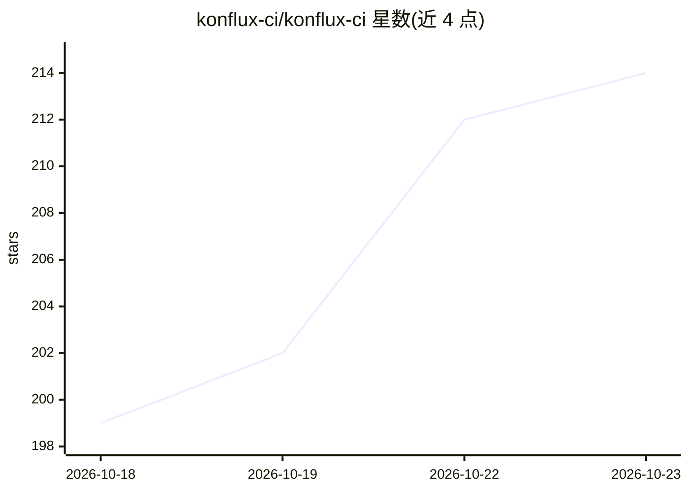

# konflux-ci/konflux-ci

⭐ 214 · Go · Apache-2.0 · 推送 2026-10-22 · [GitHub](https://github.com/konflux-ci/konflux-ci) · [官网](https://konflux-ci.dev/) · 组织维护

**Kubernetes 原生 CI/CD 平台：构建、测试与发布可信软件制品**

开源的 Kubernetes 原生 CI/CD 平台，管理软件制品从构建到发布的完整生命周期。基于 Tekton 与 Conforma 策略框架构建，由 Kubernetes operator 管理，可运行于 Kind、OpenShift 及任何合规 Kubernetes 集群。每次 PR 与合并触发 Tekton 流水线生成带 SBOM 的签名容器镜像，构建后运行集成测试并以策略门控发布，制品经 cosign 签名、SLSA provenance 证明与策略检查后发布。集成 Tekton、Buildah、Sigstore、Clair、Quay 等开源项目，可在本地 Kind 集群数分钟内部署。Apache 2.0 许可。

## 筛选速览

| 维度 | 判定 | 备注 |
|---|---|---|
| AI 角色 | `ai-ecosystem` | LLM/agent 周边工具 |
| 许可风险 | `permissive` | Apache-2.0 |
| 部署形态 | `None` |  |
| 模型依赖 | — | README 未给出锁定关系 |
| 硬件要求 | — | 无带数字的原话,不猜 |
| 安装摩擦 | `low` | 无编译、无系统依赖或容器化 |
| 成熟度 | — | 结构信号不足 |

## 能力要点

- PR/合并触发 Tekton 流水线，生成带 SBOM 的签名容器镜像
- 制品经 cosign 签名、SLSA provenance 证明与 Conforma 策略检查
- 集成 Tekton、Buildah、Sigstore、Clair、Quay、Renovate 等开源项目
- 支持在本地 Kind 集群快速部署完整实例

## 适用场景

- 在 Kubernetes 集群上运行带供应链信任的 CI/CD 流水线
- 自动生成签名镜像与 SBOM 并做策略门控发布
- 以声明式配置编排制品发布到目标镜像仓库

## 场景标签

 · 领域:云原生/CI-CD 与供应链安全

## 证据(README 行号)

> L23: Konflux is an open-source, Kubernetes-native CI/CD platform that manages the full software
> L28: Managed by a Kubernetes operator, Konflux runs on Kind, OpenShift, and any conformant Kubernetes cluster.

## 星数曲线

2026-10-18 199 → 2026-10-23 214（+15）

---
*卡片 v1 · prompt 1.4 · 生成 2026-10-22 · 置信度 low · 依据 README sha `fa701cc87bbd` · [字段定义](../../DATASET.md)*
