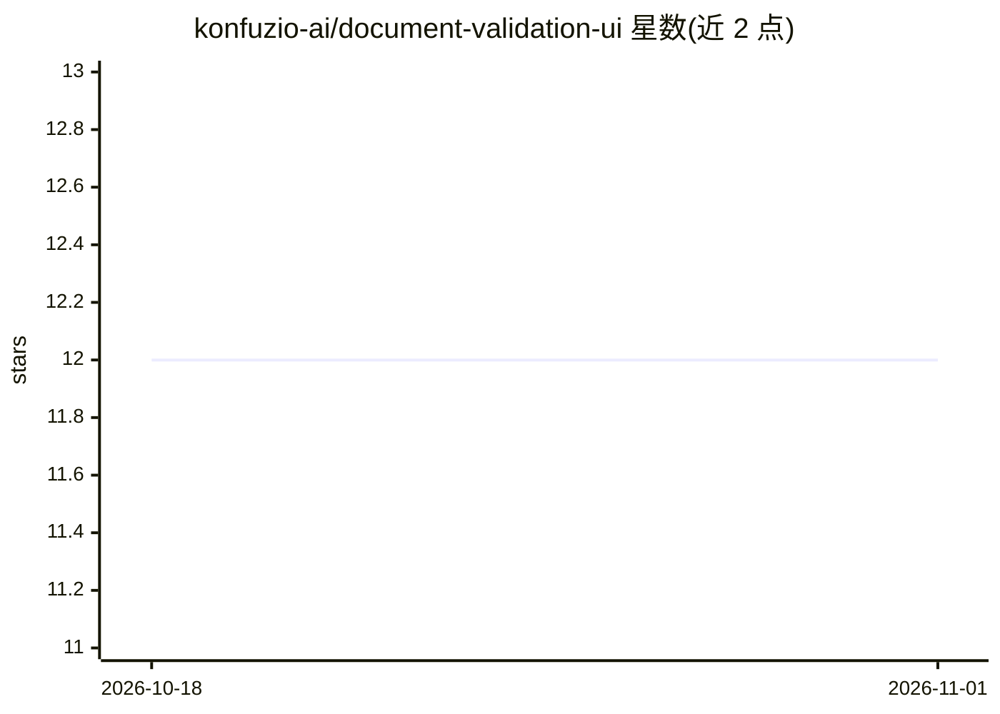

# konfuzio-ai/document-validation-ui

⭐ 12 · Vue · NOASSERTION · 推送 2026-07-14 · [GitHub](https://github.com/konfuzio-ai/document-validation-ui) · [官网](https://konfuzio.com/) · 组织维护

**面向 Konfuzio Server 的文档查看、标注与编辑 Web UI 组件**

基于 Vue.js 的 JavaScript 文档库，属 Konfuzio SDK 的一部分：与 Konfuzio Server 交互，提供开箱即用的响应式 UI，用于查看、标注和操作 PDF，可嵌入任意 Web 项目。以 npm 包形式发布（@konfuzio/document-validation-ui），并提供 GitHub release。README 链接了 Playground、开发者文档、用户手册、非技术概览与 human-in-the-loop 集成等资源。注意：该库采用商业许可（commercial license）。

## 筛选速览

| 维度 | 判定 | 备注 |
|---|---|---|
| AI 角色 | `ai-ecosystem` | LLM/agent 周边工具 |
| 许可风险 | `none` | NOASSERTION |
| 部署形态 | `None` |  |
| 模型依赖 | — | README 未给出锁定关系 |
| 硬件要求 | — | 无带数字的原话,不猜 |
| 安装摩擦 | `low` | 无编译、无系统依赖或容器化 |
| 成熟度 | — | 结构信号不足 |

## 能力要点

- 与 Konfuzio Server 交互的文档查看、标注与 PDF 操作界面
- 响应式 UI，可嵌入任意 Web 项目
- 以 npm 包形式提供并发布 GitHub release

## 适用场景

- 在 Web 项目中嵌入对上传文档的查看与标注界面
- 配合 Konfuzio Server 做文档的人工校验（human-in-the-loop）
- 为文档处理流程提供标注编辑前端

## 场景标签

 · 领域:文档 AI/前端组件

## 证据(README 行号)

> L13: The Document Validation UI is a powerful JavaScript-based document library that's part of the Konfuzio SDK. It prov
> L21: - Human-in-the-loop integration

## 星数曲线

2026-10-18 12 → 2026-11-01 12（+0）

---
*卡片 v1 · prompt 1.4 · 生成 2026-11-01 · 置信度 mid · 依据 README sha `fb6abde03479` · [字段定义](../../DATASET.md)*
