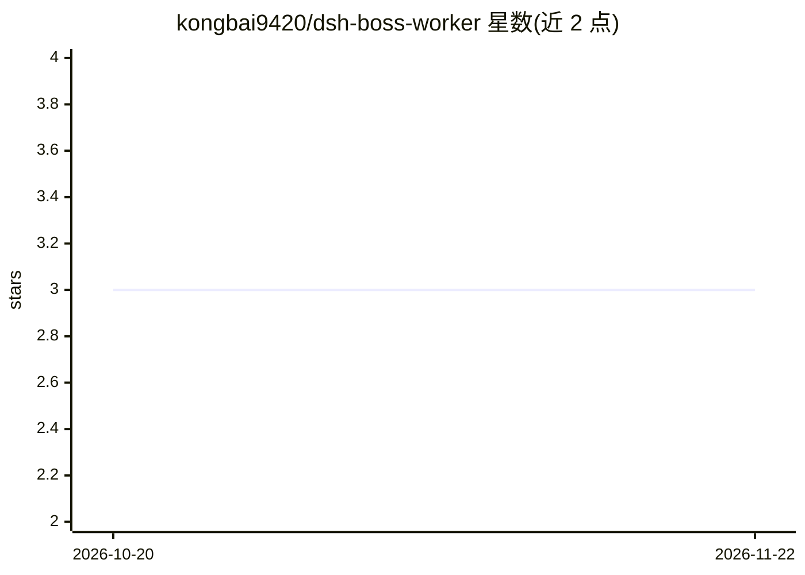

# kongbai9420/dsh-boss-worker

⭐ 3 · JavaScript · MIT · 推送 2026-10-27 · [GitHub](https://github.com/kongbai9420/dsh-boss-worker) · 个人维护 · 中文 README

**DeepSeek Harness 多模型多智能体流程编排插件**

面向 DeepSeek Harness 的本地插件：在 DSH 官方流程页签中把需求拆为节点，为每个节点选择执行模型与独立验收模型，用通过/封驳连线表达依赖与返工。支持并行 DAG、模型接管链与治理编排三类流程，提供写冲突排队、原需求逐项对账验收、Token 用量与按模型单价计价。通过 DSH 插件管理安装，或以 Node.js 24 从源码构建 .tgz 包；当前为 Beta 预发布版。

## 筛选速览

| 维度 | 判定 | 备注 |
|---|---|---|
| AI 角色 | `ai-ecosystem` | LLM/agent 周边工具 |
| 许可风险 | `permissive` | MIT |
| 部署形态 | `None` |  |
| 模型依赖 | locked-api |  |
| 硬件要求 | — | 无带数字的原话,不猜 |
| 安装摩擦 | `low` | 无编译、无系统依赖或容器化 |
| 成熟度 | `idea` | |

## 能力要点

- 节点直接配置执行模型与独立验收模型
- 按依赖与写入范围调度并行执行，写冲突排队
- 按原需求逐项对账的验收机制与核验历史
- Token 用量记录、单价设置与预估费用

## 适用场景

- 把软件项目拆成规划、实现、测试、审查节点交由多模型协作
- 用封驳连线实现审查不通过的定向返工
- 按模型单价统计多 Provider 调用的用量与费用

## 场景标签

`多智能体` `Agent 框架` · 领域:Agent 开发

## 证据(README 行号)

> L5: 面向 DeepSeek Harness 的多模型流程工作台
> L20: 在 DSH 官方“流程”页签中，把需求拆为节点，为每个节点选择 Provider / 模型，再用连线表达依赖、审查与返工。从草案到交付，模型配置、执行状态和验收依据都有记录。

## 星数曲线

2026-10-20 3 → 2026-11-22 3（+0）

---
*卡片 v1 · prompt 1.4 · 生成 2026-11-21 · 置信度 high · 依据 README sha `6660a6df9604` · [字段定义](../../DATASET.md)*
