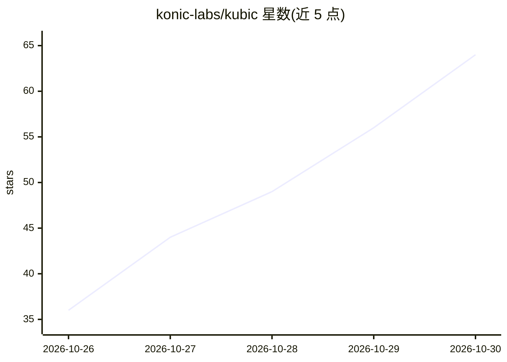

# konic-labs/kubic

⭐ 64 · TypeScript · MIT · 推送 2026-10-29 · [GitHub](https://github.com/konic-labs/kubic) · [官网](https://konic.io) · 组织维护

**面向团队/企业的终端 AI 编程代理，可控可撤销**

Konic 开源的终端编码代理（TUI，Node 22.19+）：用户自选模型（Anthropic/OpenAI/Google/Bedrock/OpenRouter 或自定义端点）执行编码任务，所有文件改动记录在可审查、可 /undo 的日志中（不依赖 git），危险操作前需经 TUI 或 broker 审批，支持会话分支（/tree）与可选 Seatbelt/bubblewrap bash 沙箱。团队功能包括托管策略、审计账本、消费上限与 OIDC。MIT 许可，npm 全局安装。

## 筛选速览

| 维度 | 判定 | 备注 |
|---|---|---|
| AI 角色 | `ai-native` | 本体是模型或模型工具 |
| 许可风险 | `permissive` | MIT |
| 部署形态 | `library` | 以包/库形式分发 |
| 模型依赖 | — | README 未给出锁定关系 |
| 硬件要求 | — | 无带数字的原话,不猜 |
| 安装摩擦 | `low` | 无编译、无系统依赖或容器化 |
| 成熟度 | — | 结构信号不足 |

## 能力要点

- 任意模型接入：Anthropic/OpenAI/Google/Bedrock/OpenRouter/自定义端点
- 每次改动入日志，/undo 可撤销（有无 git 均可）
- 危险操作审批 + 可选 Seatbelt/bubblewrap bash 沙箱
- 团队功能：托管策略、审计账本、消费上限、OIDC

## 适用场景

- 在终端用自选模型让 AI 代理完成编码任务并审查/撤销改动
- 企业为团队统一管理 AI 编程代理的策略与开销
- 在无 git 的项目中回退 AI 产生的文件改动

## 场景标签

`编码 Agent` · 领域:编码与开发

## 证据(README 行号)

> L5: **Kubic is Konic's open-source coding agent.** It runs in your terminal with the
> L18:  Anthropic, OpenAI, Google, Bedrock, OpenRouter or your own endpoint.

## 星数曲线

2026-10-26 36 → 2026-10-30 64（+28）

---
*卡片 v1 · prompt 1.4 · 生成 2026-10-25 · 置信度 high · 依据 README sha `c012f73a390f` · [字段定义](../../DATASET.md)*
