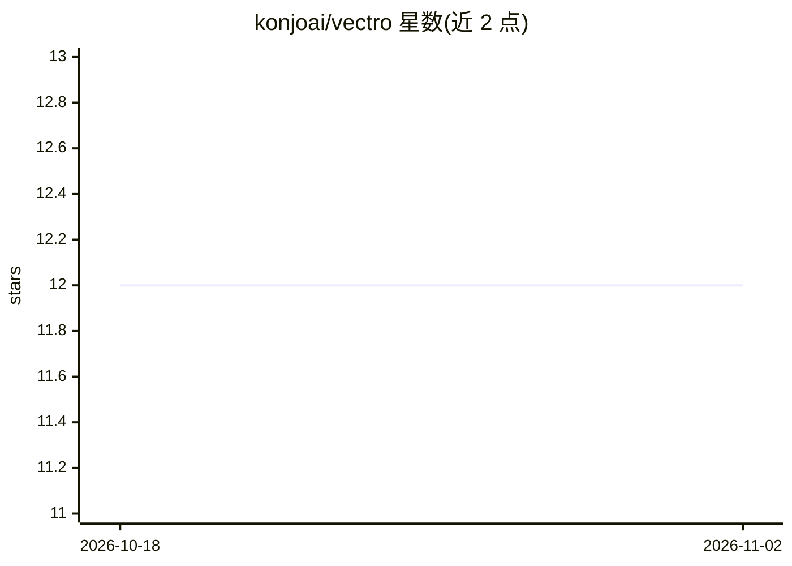

# konjoai/vectro

⭐ 12 · Rust · MIT · 推送 2026-08-19 · [GitHub](https://github.com/konjoai/vectro) · [官网](https://github.com/konjoai/vectro) · 组织维护

**面向向量数据库与本地 AI 研究的嵌入量化压缩库（Mojo 加速）**

用 Mojo 编写的嵌入向量量化压缩库，提供 INT8/NF4/PQ/Binary/RQ 等多种量化模式，压缩比从 4× 到 48×，并内置 HNSW 近似最近邻索引。默认 Python/NumPy 模式即可运行（约 167K–210K vec/s），安装 Mojo 二进制后宣称达 12M+ vec/s。面向使用向量数据库和做本地 AI 研究的开发者，支持 Qdrant/Weaviate/Milvus/Chroma/Pinecone 连接器及 LangChain/LlamaIndex/Haystack/DSPy 集成，另可压缩 LoRA 适配器矩阵。通过 pip 安装，跨 macOS/Linux/Windows 平台。

## 筛选速览

| 维度 | 判定 | 备注 |
|---|---|---|
| AI 角色 | `ai-ecosystem` | LLM/agent 周边工具 |
| 许可风险 | `permissive` | MIT |
| 部署形态 | `library` | 以包/库形式分发 |
| 模型依赖 | — | README 未给出锁定关系 |
| 硬件要求 | — | 无带数字的原话,不猜 |
| 安装摩擦 | `low` | 无编译、无系统依赖或容器化 |
| 成熟度 | — | 结构信号不足 |

## 能力要点

- INT8/NF4/PQ-96/Binary/RQ 多种量化模式，4× 至 48× 压缩
- 内置 HNSW 近似最近邻索引，内存占用较 float32 降至 1/38
- Python-only 模式默认可用，Mojo SIMD 加速为可选增强
- 6 种向量数据库连接器与 LangChain/LlamaIndex/Haystack/DSPy 集成
- 可压缩 LoRA 适配器矩阵（4×–32×）并支持 S3/GCS/Azure 存储

## 适用场景

- 压缩向量数据库中的嵌入以降低内存占用
- 为 RAG 检索系统提供量化嵌入与 ANN 搜索
- 批量存储数千个按文档/任务划分的 LoRA 适配器

## 场景标签

`模型量化` `向量数据库` · 领域:知识与检索

## 证据(README 行号)

> L24: A vector quantization library with Mojo SIMD acceleration and comprehensive Python bindings for compressing LLM emb
> L57: - `pip install "vectro[integrations]"` for Qdrant, Weaviate connectors
> L297: ## 🔗 Vector Database Integrations

## 星数曲线

2026-10-18 12 → 2026-11-02 12（+0）

---
*卡片 v1 · prompt 1.4 · 生成 2026-11-01 · 置信度 high · 依据 README sha `e8d485af1ef7` · [字段定义](../../DATASET.md)*
