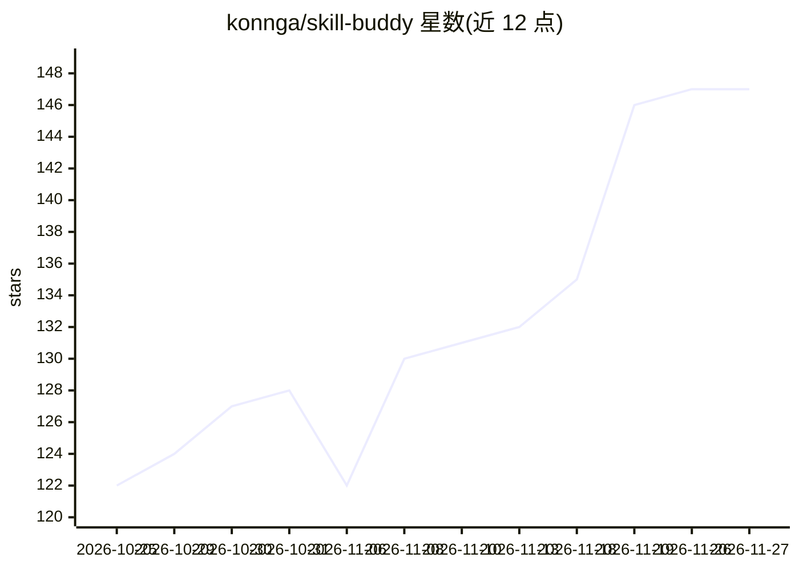

# konnga/skill-buddy

⭐ 147 · TypeScript · MIT · 推送 2026-11-19 · [GitHub](https://github.com/konnga/skill-buddy) · 个人维护 · 中文 README

**为多 AI 编码代理统一管理/安装/同步 Skills 与 MCP 的桌面工作台**

基于 Electron + Vue 3 的桌面应用，把散落在各 AI 编码工具中的 Skills、MCP 配置与指令文件（AGENTS.md/CLAUDE.md 等）汇聚到一个界面：自动发现并聚合本地安装、跨平台批量安装、检测漂移并按基线同步、展示每个工具实际加载的有效指令链，并从 skills.sh/SkillHub/GitHub 发现资源。提供内置中英双语界面，通过 GitHub Releases 分发安装包；自托管 Registry 与 CLI 为可选独立组件。团队可经 Git 分支与 PR/MR 管理已审核资源。

## 筛选速览

| 维度 | 判定 | 备注 |
|---|---|---|
| AI 角色 | `ai-ecosystem` | LLM/agent 周边工具 |
| 许可风险 | `permissive` | MIT |
| 部署形态 | `desktop` | 安装包/桌面程序 |
| 模型依赖 | — | README 未给出锁定关系 |
| 硬件要求 | — | 无带数字的原话,不猜 |
| 安装摩擦 | `low` | 无编译、无系统依赖或容器化 |
| 成熟度 | — | 结构信号不足 |

## 能力要点

- 自动发现并聚合 19 种代理的 Skills、MCP Server 与指令文件
- 漂移检测、基线同步与有效指令链展示（含被遮蔽条目）
- 跨工具桥接：仅为 AGENTS.md 的项目可生成 Claude Code 桥
- 私有 Git 备份与受保护分支的团队库、CI 合规检查

## 适用场景

- 在多个 AI 编码工具间统一安装和同步同一套 Skills
- 排查不同工具指令文件的冲突、漂移与失效链接
- 团队用 Git 仓库管理已审核的 Skills 并在 CI 中强制合规

## 场景标签

 · 领域:AI 开发工具/配置管理

## 证据(README 行号)

> L24:  A desktop workspace for managing, installing, and synchronizing Skills, MCP Servers, and AI instruction files acro
> L32: SkillBuddy brings Skills, MCP configurations, and AI instruction files scattered across different AI coding tools i
> L72: - **Unified inventory**: automatically discover and aggregate Skills, MCP Servers, and AI instruction files across 

## 星数曲线

2026-10-25 122 → 2026-11-27 147（+25）

---
*卡片 v1 · prompt 1.4 · 生成 2026-11-27 · 置信度 mid · 依据 README sha `e8766ee55ebd` · [字段定义](../../DATASET.md)*
