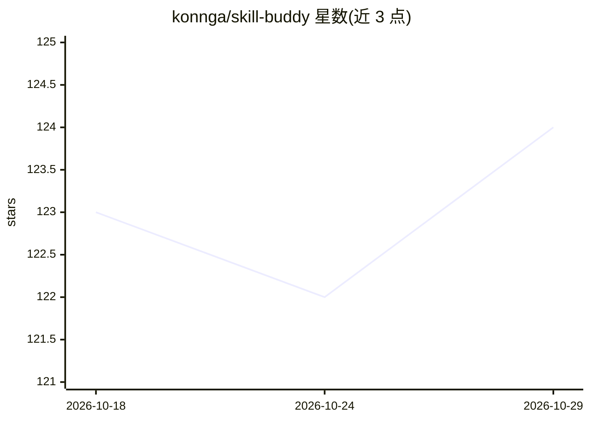

# konnga/skill-buddy

⭐ 124 · TypeScript · MIT · 推送 2026-10-15 · [GitHub](https://github.com/konnga/skill-buddy) · 个人维护 · 中文 README

**桌面工作台：跨 AI 编码代理统一管理 Skills 与 MCP Servers**

基于 Electron + Vue 3 的桌面应用，把散落在各 AI 编码工具（Claude Code、Codex、Cursor、Gemini CLI 等 18 种代理）中的 Skills、MCP Server 配置与 AI 指令文件（AGENTS.md/CLAUDE.md 等）汇聚到单一界面。提供本地安装检测、跨平台分发、漂移与规则文件冲突同步、有效指令链查看、市场发现（skills.sh/SkillHub/GitHub）与基于 Git 的团队资产库；改动经过审核计划并可撤销。macOS/Windows/Linux 提供安装包，需自行从 GitHub Releases 下载，macOS 未公证。

## 筛选速览

| 维度 | 判定 | 备注 |
|---|---|---|
| AI 角色 | `ai-ecosystem` | LLM/agent 周边工具 |
| 许可风险 | `permissive` | MIT |
| 部署形态 | `desktop` | 安装包/桌面程序 |
| 模型依赖 | — | README 未给出锁定关系 |
| 硬件要求 | — | 无带数字的原话,不猜 |
| 安装摩擦 | `low` | 无编译、无系统依赖或容器化 |
| 成熟度 | `idea` | |

## 能力要点

- 18 种 AI 代理的 Skills/MCP/指令文件统一清单与跨平台安装
- 漂移检测、冲突同步与可撤销的审核式写入计划
- AGENTS.md/CLAUDE.md 有效指令链、诊断与跨工具桥接
- Git 私有备份与团队库（保护分支、PR/MR、CI 合规检查）

## 适用场景

- 在多个 AI 编码代理间同步安装同一批 Skills 和 MCP 配置
- 排查项目规则文件漂移、重复与失效的 @path 引用
- 团队通过 Git 审核分发 Skills、MCP 定义与角色捆绑包

## 场景标签

 · 领域:AI 开发工具/配置管理

## 证据(README 行号)

> L13: SkillBuddy brings Skills, MCP configurations, and AI instruction files scattered across different AI coding tools i
> L71: SkillBuddy includes built-in Skill directory conventions for:

## 星数曲线

2026-10-18 123 → 2026-10-29 124（+1）

---
*卡片 v1 · prompt 1.4 · 生成 2026-10-23 · 置信度 mid · 依据 README sha `e492aaf7e5b4` · [字段定义](../../DATASET.md)*
