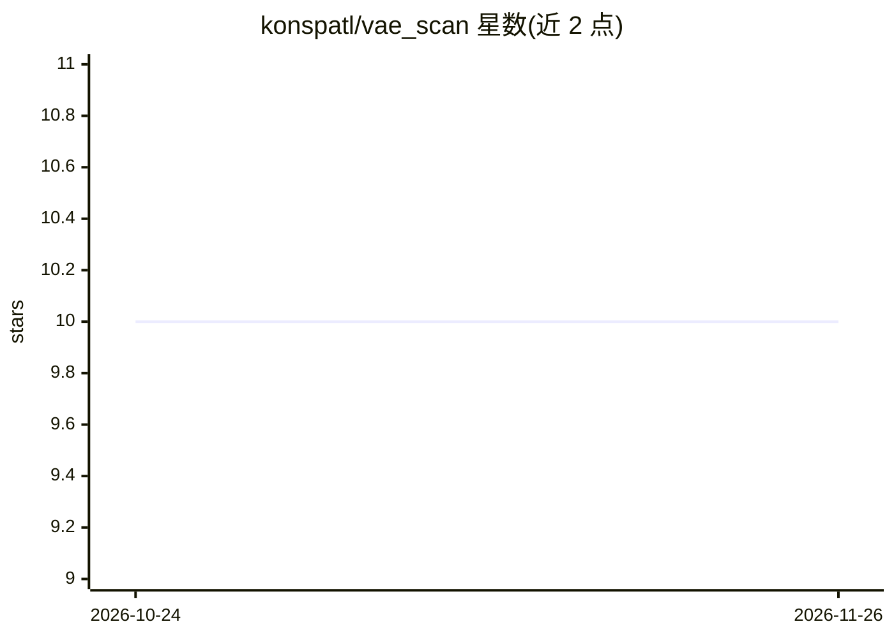

# konspatl/vae_scan

⭐ 10 · Python · BSD-3-Clause · 推送 2026-04-27 · [GitHub](https://github.com/konspatl/vae_scan) · 组织维护

**面向心电 XAI 分析的深度学习库：可解释 ECG 建模框架**

VAE-SCAN 是一个基于变分自编码器的可解释心电（ECG）分析深度学习库，架构本身具备可解释性，用于发现 ECG 特征与临床因素之间的双向关联。README 列出其满足的四条 XAI 要求（概念映射到可解释域、单调关联解释、解释保真度、鲁棒性）。以 Python 包形式从源码安装，训练/测试通过 JSON 配置文件驱动，示例用法在 notebooks 中提供，另附在线交互式可视化站点，并给出对应 npj Digital Medicine 论文引用。

## 筛选速览

| 维度 | 判定 | 备注 |
|---|---|---|
| AI 角色 | `ai-native` | 本体是模型或模型工具 |
| 许可风险 | `permissive` | BSD-3-Clause |
| 部署形态 | `library` | 以包/库形式分发 |
| 模型依赖 | — | README 未给出锁定关系 |
| 硬件要求 | — | 无带数字的原话,不猜 |
| 安装摩擦 | `low` | 无编译、无系统依赖或容器化 |
| 成熟度 | — | 结构信号不足 |

## 能力要点

- 内在可解释的变分自编码器架构，支持 ECG 特征与临床因素的双向关联发现
- 通过 JSON 配置文件驱动数据集、标签、划分与训练/测试流程
- 提供 VAE 与 SCAN 模型的训练、测试与可视化示例 notebooks
- 配套在线交互式可视化站点

## 适用场景

- 训练可解释的心电图分析模型
- 研究 ECG 特征与临床指标的关联并做可视化
- 复现论文中的 XAI-ECG 实验

## 场景标签

`科研工具` · 领域:学习与行业

## 证据(README 行号)

> L2: A deep learning library for XAI-ECG analysis.
> L12: VAE-SCAN is a variational autoencoder framework for explainable ECG analysis. This framework consists of an inheren

## 星数曲线

2026-10-24 10 → 2026-11-26 10（+0）

---
*卡片 v1 · prompt 1.4 · 生成 2026-11-19 · 置信度 high · 依据 README sha `c6d3099c2071` · [字段定义](../../DATASET.md)*
