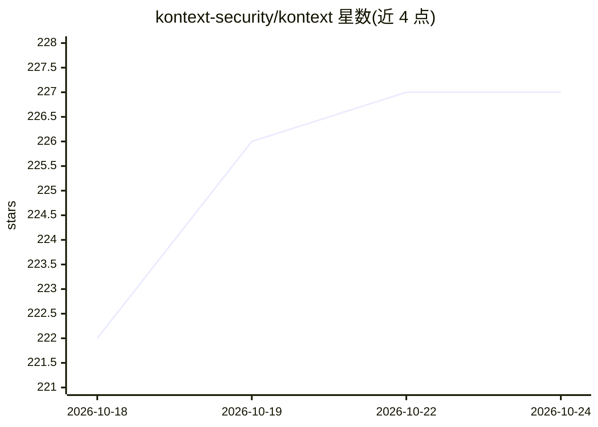

# kontext-security/kontext

⭐ 227 · Go · MIT · 推送 2026-10-23 · [GitHub](https://github.com/kontext-security/kontext) · [官网](https://app.kontext.security) · 组织维护

**为 AI agent 提供本地策略拦截与授权审计的安全运行时**

Kontext 在 AI agent（Claude Code、Claude Cowork、Codex）与工具调用之间插入本地策略层：观察模式下记录策略决策，强制模式在同步 pre-action hook 处拒绝匹配的危险动作，并把决策与结果写入授权账本，保留 agent、会话、策略与脱敏证据。通过 brew 安装、kontext setup 一键部署 hooks 与本地 daemon，无需包装命令即可继续正常使用 agent。自服务安装目前仅支持 macOS；策略评估出错或 daemon 不可用时不阻断调用。提供组织级策略分发、证据导出与审计留存，自述不提供内核级隔离。

## 筛选速览

| 维度 | 判定 | 备注 |
|---|---|---|
| AI 角色 | `ai-ecosystem` | LLM/agent 周边工具 |
| 许可风险 | `permissive` | MIT |
| 部署形态 | `None` |  |
| 模型依赖 | locked-api |  |
| 硬件要求 | — | 无带数字的原话,不猜 |
| 安装摩擦 | `low` | 无编译、无系统依赖或容器化 |
| 成熟度 | — | 结构信号不足 |

## 能力要点

- 本地策略评估，observe/enforce 两阶段推进
- pre-tool-use 同步 hook 拦截危险动作（命令、敏感文件、凭据访问等）
- 授权账本记录 agent、会话、策略决策与脱敏证据
- 支持 Claude Code、Claude Cowork、Codex，brew 安装无 wrapper

## 适用场景

- 上线前观察 agent 工具调用与策略命中情况
- 阻断 agent 执行破坏性命令或访问生产系统与凭据
- 合规审计与事件调查时回溯决策证据

## 场景标签

`网络安全` · 领域:学习与行业

## 证据(README 行号)

> L20: **Kontext puts local policy between AI agents and the tools they call.** It
> L21: observes supported actions, evaluates policy before consequential actions run,

## 星数曲线

2026-10-18 222 → 2026-10-24 227（+5）

---
*卡片 v1 · prompt 1.4 · 生成 2026-10-22 · 置信度 high · 依据 README sha `2dab4e060d8c` · [字段定义](../../DATASET.md)*
