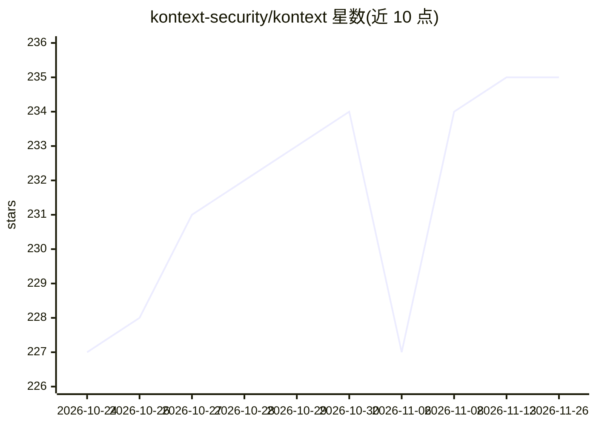

# kontext-security/kontext

⭐ 235 · Go · MIT · 推送 2026-11-25 · [GitHub](https://github.com/kontext-security/kontext) · [官网](https://kontext.security) · 组织维护

**为 AI agent 提供本地策略拦截与授权审计的安全运行时**

以 Go 编写的本地安全层：在 AI agent 与其调用的工具之间插入策略评估，在支持的前置钩子处对动作做观察或阻断决策，并将 agent、会话、动作、策略决定与结果写入本地授权账本。采用先观察后强制（observe/enforce）的分阶段上线模式，托管部署提供组织级策略分发、身份控制与脱敏记录导出。决策路径保持在本地，无法取回决定时不阻断工具调用。当前支持 Claude Code、Claude Cowork、Codex、Cursor、Antigravity，覆盖范围因 agent 而异。

## 筛选速览

| 维度 | 判定 | 备注 |
|---|---|---|
| AI 角色 | `ai-ecosystem` | LLM/agent 周边工具 |
| 许可风险 | `permissive` | MIT |
| 部署形态 | `desktop` | 安装包/桌面程序 |
| 模型依赖 | — | README 未给出锁定关系 |
| 硬件要求 | — | 无带数字的原话,不猜 |
| 安装摩擦 | `low` | 无编译、无系统依赖或容器化 |
| 成熟度 | — | 结构信号不足 |

## 能力要点

- 在前置同步钩子处评估策略并可在动作执行前阻断
- 授权账本记录 agent、会话、动作、策略决定与结果
- observe/enforce 两模式分阶段上线
- 不使用包装命令，安装后按原方式继续使用 agent

## 适用场景

- 在团队中限制 agent 执行破坏性命令或访问敏感文件
- 调查 agent 安全事件时回溯每次动作的授权证据
- 满足合规审计对生产系统操作留痕的要求

## 场景标签

`网络安全` · 领域:学习与行业

## 证据(README 行号)

> L20: **Kontext puts local policy between AI agents and the tools they call.** It
> L45: Kontext currently supports **Claude Code, Claude Cowork, Codex, Cursor, and
> L181: Enforcement is intentionally limited to event surfaces where the agent waits

## 星数曲线

2026-10-24 227 → 2026-11-26 235（+8）

---
*卡片 v1 · prompt 1.4 · 生成 2026-11-25 · 置信度 high · 依据 README sha `dadd172b76f2` · [字段定义](../../DATASET.md)*
