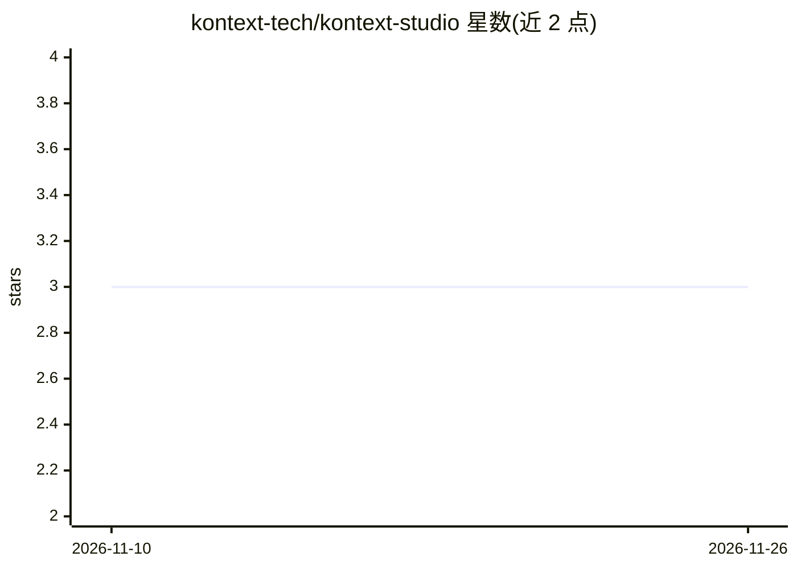

# kontext-tech/kontext-studio

⭐ 3 · Python · MIT · 推送 2026-11-24 · [GitHub](https://github.com/kontext-tech/kontext-studio) · [官网](https://kontext.tech) · 组织维护

**本地优先的对话式数据分析工作台：多 agent 查询数据并给出可复现答案**

开源的本地优先对话式分析工作台：用户以自然语言提问，协调器将任务分派给 SQL、图表、notebook、Python 等专家 agent，每个答案附带可检查与重跑的 SQL、图表、代码或 notebook。数据源支持本地管理的 lakehouse 及 DuckDB/SQLite/PostgreSQL/MySQL 连接；模型可接 Ollama、LM Studio 或云端服务。应用、API、job worker 与 Python 内核均运行在同一台机器。提供桌面安装包与 PyPI 包两种分发方式。

## 筛选速览

| 维度 | 判定 | 备注 |
|---|---|---|
| AI 角色 | `ai-native` | 本体是模型或模型工具 |
| 许可风险 | `permissive` | MIT |
| 部署形态 | `desktop` | 安装包/桌面程序 |
| 模型依赖 | local-ok | 支持本地模型 |
| 硬件要求 | — | 无带数字的原话,不猜 |
| 安装摩擦 | `low` | 无编译、无系统依赖或容器化 |
| 成熟度 | — | 结构信号不足 |

## 能力要点

- 多 agent 协作（SQL/图表/notebook/Python），工具调用全程可见
- 答案附带可复现的 SQL、图表、Python 代码或 notebook
- 支持本地 lakehouse 及 DuckDB/SQLite/PostgreSQL/MySQL 数据源
- 本地可接 Ollama/LM Studio，云端可接 OpenAI/Anthropic/Gemini/Bedrock

## 适用场景

- 用自然语言查询本地文件和数据库并生成分析
- 让 agent 生成带 SQL 和 Python 的可复现分析 notebook
- 在本地环境用自有模型分析数据，提示词只发给自己配置的模型服务

## 场景标签

`多智能体` `数据分析` · 领域:Agent 开发

## 证据(README 行号)

> L5: **Kontext Studio is an open-source, local-first conversational analytics
> L7: agents, powered by the model you prefer, queries your files and databases —
> L21: - **Ask, don't assemble** — a coordinator routes work to SQL, chart, notebook,

## 星数曲线

2026-11-10 3 → 2026-11-26 3（+0）

---
*卡片 v1 · prompt 1.4 · 生成 2026-11-21 · 置信度 mid · 依据 README sha `6352d896adbb` · [字段定义](../../DATASET.md)*
