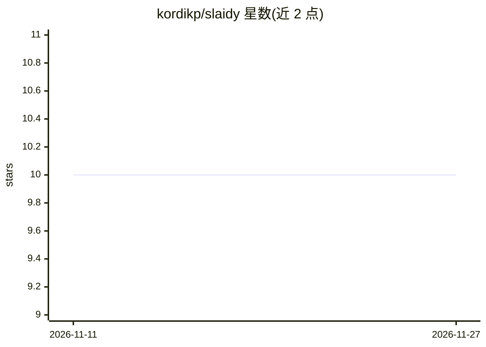

# kordikp/slaidy

⭐ 10 · HTML · MIT · 推送 2026-11-16 · [GitHub](https://github.com/kordikp/slaidy) · [官网](https://kordikp.github.io/slaidy/) · 个人维护

**单文件 HTML 幻灯片编辑器，deck 以 markdown+SVG 存盘**

单个 HTML 文件的幻灯片编辑器，deck 在磁盘上始终是 markdown 与 SVG 文件，可用 git 跟踪、grep 与版本管理。浏览器内编辑，支持全屏演示、PDF/HTML/JSON 导出、十二次版本快照；AI 面板可按描述生成幻灯片与生成 SVG 图形，key 存于 .env 由本地脚本代理调用，浏览器不持有 key。除 AI 面板外全部功能无需模型即可运行。面向需要长期维护、复用幻灯片的讲者与教师。

## 筛选速览

| 维度 | 判定 | 备注 |
|---|---|---|
| AI 角色 | `ai-native` | 本体是模型或模型工具 |
| 许可风险 | `permissive` | MIT |
| 部署形态 | `None` |  |
| 模型依赖 | local-ok | 支持本地模型 |
| 硬件要求 | — | 无带数字的原话,不猜 |
| 安装摩擦 | `low` | 无编译、无系统依赖或容器化 |
| 成熟度 | — | 结构信号不足 |

## 能力要点

- 单 HTML 文件、零依赖、无构建步骤，file:// 直接打开
- deck 保持 markdown + SVG，每次保存写盘并留十二次快照
- AI 面板可生成幻灯片与 SVG 图形，key 经本地 studio.sh 代理
- 支持 GitLab OAuth(PKCE) 回存编辑、?deck=URL 共享、主题库

## 适用场景

- 维护多次讲授、需要进 git 的长期幻灯片
- 让 coding agent 把 PowerPoint/Keynote/Google Slides 转成 markdown deck
- 一个班级通过 URL 共享并编辑同一份 deck
- 发布带讲者注释与逐页解说的演讲链接

## 场景标签

`AI 写作` · 领域:内容生成

## 证据(README 行号)

> L3: **A slide editor in one HTML file, where the deck stays a folder of markdown.**
> L184: |**Ask**|say what a slide is for and it writes the slide; ask what it would change and it answers with a list you 
> L65: - **A model on this machine** — Ollama, LM Studio, llama.cpp, vLLM: no key, because there is

## 星数曲线

2026-11-11 10 → 2026-11-27 10（+0）

---
*卡片 v1 · prompt 1.4 · 生成 2026-11-19 · 置信度 high · 依据 README sha `afb35e51eb9c` · [字段定义](../../DATASET.md)*
