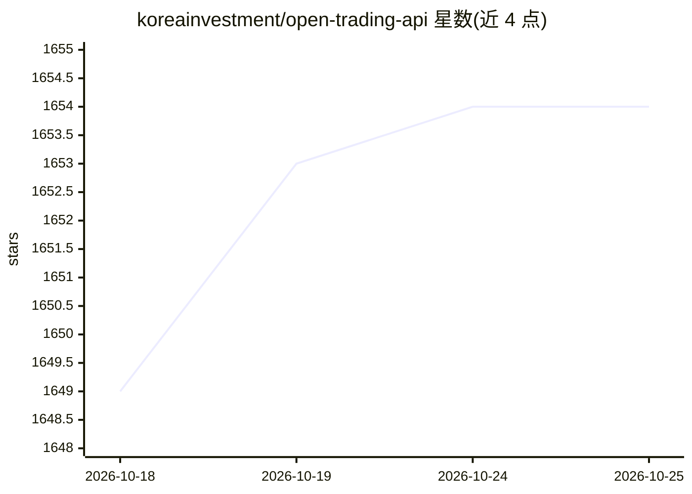

# koreainvestment/open-trading-api

⭐ 1,654 · Python · 推送 2026-10-23 · [GitHub](https://github.com/koreainvestment/open-trading-api) · [官网](https://apiportal.koreainvestment.com) · 组织维护 · 中文 README

**韩国投资证券 Open API 官方示例代码库，供开发者和 LLM 使用**

韩国投资证券(KIS)官方维护的 Open API 示例代码仓库，面向 Python 开发者和 LLM 代码代理两类用户。提供按功能单元拆分便于 LLM 探索调用的 examples_llm、按产品类别整合的 examples_user，覆盖国内/海外股票、债券、期货期权、ETF/ETN 等 API 类别，含认证与 WebSocket 公共模块。另提供可视化策略设计器（80 个技术指标、10 个预设策略）、基于 Docker QuantConnect Lean 的回测引擎及 MCP 目录。运行需 Python 3.11+、KIS 账户与 App Key 配置；提供 llms.txt 供 LLM 读取。

## 筛选速览

| 维度 | 判定 | 备注 |
|---|---|---|
| AI 角色 | `ai-ecosystem` | LLM/agent 周边工具 |
| 许可风险 | `none` | — |
| 部署形态 | `None` |  |
| 模型依赖 | — | README 未给出锁定关系 |
| 硬件要求 | — | 无带数字的原话,不猜 |
| 安装摩擦 | `low` | 无编译、无系统依赖或容器化 |
| 成熟度 | — | 结构信号不足 |

## 能力要点

- examples_llm 按单一 API 功能独立成目录，便于 LLM 探索与调用
- strategy_builder 提供 80 个技术指标与 10 个预设策略，输出 BUY/SELL/HOLD 信号
- backtester 基于 Docker 的 QuantConnect Lean 引擎并生成 HTML 报告
- 提供 llms.txt 帮助 LLM 与 AI 代理导航仓库

## 适用场景

- 接入韩国投资证券 Open API 实现行情查询与下单
- 让 LLM 代码代理基于功能单元示例实现自动交易
- 用可视化策略设计器生成策略并回测验证后执行

## 场景标签

`金融量化` · 领域:学习与行业

## 证据(README 行号)

> L18: 이 저장소는 **ChatGPT, Claude 등 LLM(Large Language Model)** 기반 자동화 환경과 Python 개발자 모두가
> L21: - `examples_llm/`: LLM이 단일 API 기능을 쉽게 탐색하고 호출할 수 있도록 구성된 기능 단위 샘플 코드
> L99: |`MCP/`|AI 도구 연결|KIS Code Assistant + Trading MCP (README)|

## 星数曲线

2026-10-18 1,649 → 2026-10-25 1,654（+5）

---
*卡片 v1 · prompt 1.4 · 生成 2026-10-21 · 置信度 high · 依据 README sha `ba90815a21cd` · [字段定义](../../DATASET.md)*
