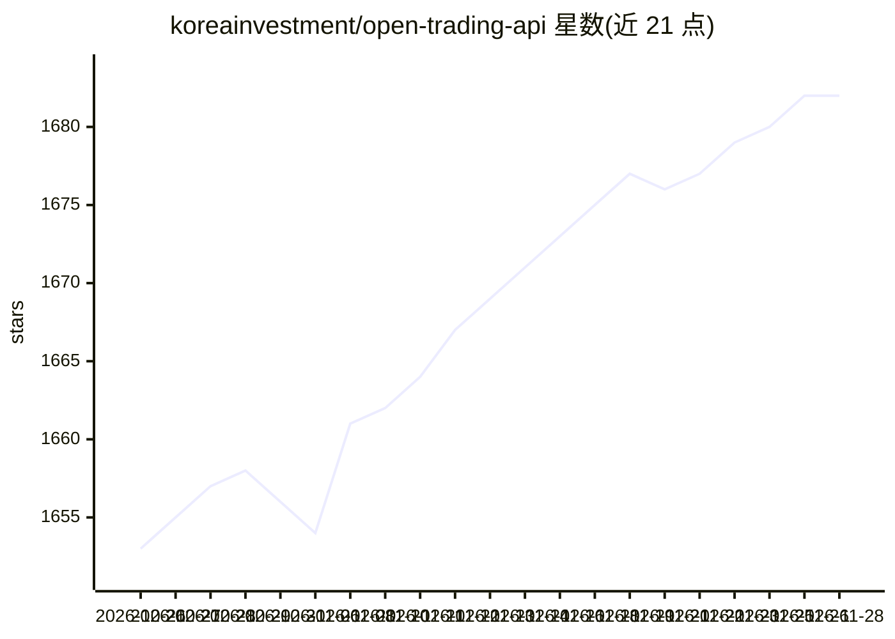

# koreainvestment/open-trading-api

⭐ 1,682 · Python · 推送 2026-11-24 · [GitHub](https://github.com/koreainvestment/open-trading-api) · [官网](https://apiportal.koreainvestment.com) · 组织维护 · 中文 README

**韩国投资证券 Open API 的示例代码库（含 LLM 导航支持）**

韩国投资证券（KIS）官方维护的 Open API 示例代码仓库，面向 Python 开发者与 LLM 代码 Agent。包含供 LLM 单功能浏览调用的 examples_llm、供用户实现投资与自动交易的 examples_user，以及 strategy_builder（80 个技术指标、10 个预设策略）、backtester（基于 Docker 运行 QuantConnect Lean）构成的策略设计→回测→下单流水线，并提供 MCP 目录连接 AI 工具。需申请 API 密钥并在 kis_devlp.yaml 配置账户信息后方可运行。

## 筛选速览

| 维度 | 判定 | 备注 |
|---|---|---|
| AI 角色 | `ai-knowledge` | 知识聚合/清单类 |
| 许可风险 | `none` | — |
| 部署形态 | `None` |  |
| 模型依赖 | — | README 未给出锁定关系 |
| 硬件要求 | — | 无带数字的原话,不猜 |
| 安装摩擦 | `low` | 无编译、无系统依赖或容器化 |
| 成熟度 | — | 结构信号不足 |

## 能力要点

- 提供 llms.txt 供 ChatGPT、Claude 等 LLM/Agent 浏览仓库
- examples_llm 按单一 API 功能拆分目录，含单行调用与测试文件
- strategy_builder→backtester 共享 .kis.yaml 策略格式，支持 10 个预设策略
- kis_auth.py 支持访问令牌管理与实盘/模拟环境切换

## 适用场景

- 用 LLM 代码 Agent 实现韩国股票/债券/期货期权的行情查询与自动交易
- 通过可视化 UI 设计交易策略并导出回测验证
- 初学韩国投资证券 Open API 的 Python 开发者查阅调用示例

## 场景标签

`金融量化` · 领域:学习与行业

## 证据(README 行号)

> L37: 이 저장소는 **ChatGPT, Claude 등 LLM(Large Language Model)** 기반 자동화 환경과 Python 개발자 모두가
> L40: - `examples_llm/`: LLM이 단일 API 기능을 쉽게 탐색하고 호출할 수 있도록 구성된 기능 단위 샘플 코드
> L105: 샘플 코드 외에, Open API를 활용한 **전략 설계 → 백테스팅 → 주문 실행** 파이프라인을 제공합니다.

## 星数曲线

2026-10-26 1,653 → 2026-11-28 1,682（+29）

---
*卡片 v1 · prompt 1.4 · 生成 2026-11-23 · 置信度 high · 依据 README sha `581e9e973294` · [字段定义](../../DATASET.md)*
