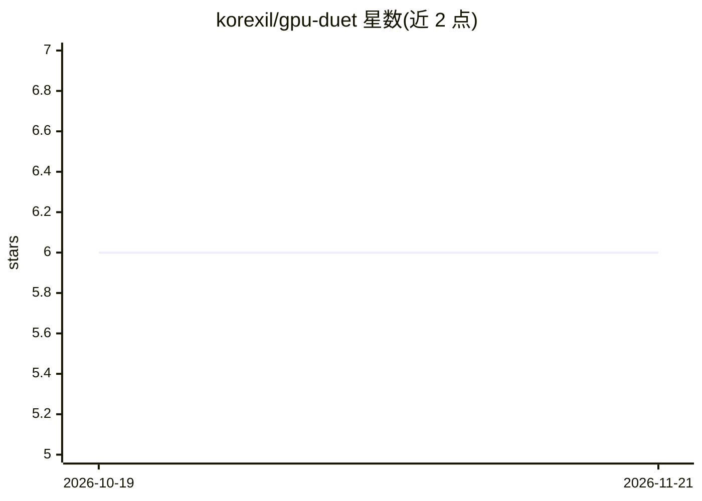

# korexil/gpu-duet

⭐ 6 · Python · Apache-2.0 · 推送 2026-10-17 · [GitHub](https://github.com/korexil/gpu-duet) · 个人维护 · 中文 README

**本地 LLM 与声音克隆 TTS 共用 8 GB 显卡的语音服务端**

在一块 8 GB NVIDIA 显卡上同时部署本地 LLM（Gemma 4 E4B，llama.cpp 推理）与零样本声音克隆 TTS（Qwen3-TTS 1.7B，打补丁的 C++ 原生引擎），通过 GPU 轮流调度、显存压缩补丁与逐句响度整形，实现边生成边播放的低断音长回答。可作普通本地 HTTP 服务供自己的程序调用，也可作为 ESP32 小智（xiaozhi）语音板的服务端（独立模式或接入 xiaozhi-esp32-server）。仅实测 Windows 10/11 + RTX 4060 Laptop。

## 筛选速览

| 维度 | 判定 | 备注 |
|---|---|---|
| AI 角色 | `ai-ecosystem` | LLM/agent 周边工具 |
| 许可风险 | `permissive` | Apache-2.0 |
| 部署形态 | `desktop` | 安装包/桌面程序 |
| 模型依赖 | local-ok | 支持本地模型 |
| 硬件要求 | `gpu-8g` | |
| 安装摩擦 | `medium` | 含编译或系统依赖之一 |
| 成熟度 | — | 结构信号不足 |

## 能力要点

- 单块 8 GB 显卡装下 LLM + 声音克隆 TTS，实测占用约 7.3 GB
- LLM 写完一句暂停、等 TTS 合成完再继续的 GPU 轮流调度
- TTS 引擎补丁（Q/K/V 权重去重、嵌入表放 CPU）省约 1 GB 显存
- 全离线运行，提供 HTTP 流式合成接口与三种部署用法

## 适用场景

- 给 ESP32 小智语音板搭一个全离线的本地语音助手服务端
- 为自己的程序提供本地 LLM 与声音克隆 TTS 的 HTTP 接口
- 在低显存条件下让 LLM 和 TTS 同时驻留一块 GPU

## 场景标签

`语音 Agent` `语音合成` · 领域:对话与助手

## 证据(README 行号)

> L31: - **全部离线，跑在一台 Windows 电脑上**：可以当普通的本地 HTTP 服务用，也可以直接给 ESP32 小智板子当服务端。
> L53: |**A. 不接板子**|给自己的程序、别的语音框架当本地 LLM + TTS|`tts-service` + `llama-server`|不要|
> L125: 到这一步就是用法 A：自己的程序调 `http://127.0.0.1:18766/stream` 合成语音，接口见 tts-service/README.md。

## 星数曲线

2026-10-19 6 → 2026-11-21 6（+0）

---
*卡片 v1 · prompt 1.4 · 生成 2026-11-20 · 置信度 high · 依据 README sha `1a24076b84f2` · [字段定义](../../DATASET.md)*
