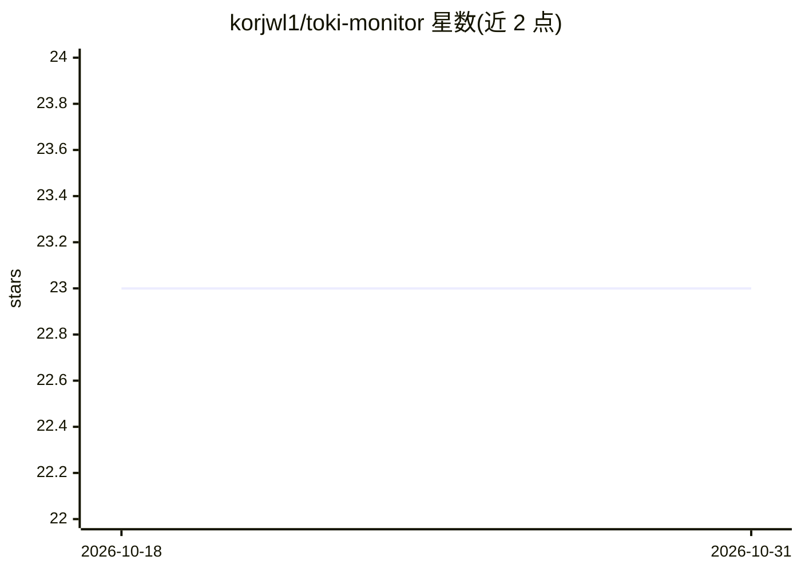

# korjwl1/toki-monitor

⭐ 23 · Swift · MIT · 推送 2026-08-27 · [GitHub](https://github.com/korjwl1/toki-monitor) · 个人维护

**macOS 菜单栏应用：实时监控 Claude Code 与 Codex CLI 的 token 用量**

面向 macOS 14+ 的 Swift/SwiftUI 菜单栏应用，通过名为 toki 的 Rust 守护进程以 kqueue 事件驱动方式读取 Claude Code 与 Codex CLI 的会话文件，将 token 数据写入内嵌 TSDB 并支持 PromQL 查询。菜单栏提供动画角色、数字速率与迷你图三种显示模式，仪表盘支持时序图、饼图与项目级分解，另有 Plan Fit 28 天订阅计划分析、速率异常告警与 toki-sync 多设备同步。经 Homebrew Cask 安装并自动附带 toki，也可用 Xcode 从源码构建；Google Gemini CLI 支持列为计划中。

## 筛选速览

| 维度 | 判定 | 备注 |
|---|---|---|
| AI 角色 | `ai-ecosystem` | LLM/agent 周边工具 |
| 许可风险 | `permissive` | MIT |
| 部署形态 | `None` |  |
| 模型依赖 | — | README 未给出锁定关系 |
| 硬件要求 | — | 无带数字的原话,不猜 |
| 安装摩擦 | `medium` | 含编译或系统依赖之一 |
| 成熟度 | — | 结构信号不足 |

## 能力要点

- toki Rust 守护进程以 kqueue 事件驱动采集，数据存入内嵌 TSDB 并支持 PromQL 查询
- 菜单栏三种显示模式（动画角色/数字速率/迷你图）与仪表盘多面板自定义
- Plan Fit：基于速率限制窗口的 28 天订阅计划分析，样本不足时拒绝给出建议
- toki-sync 服务器模式跨设备聚合用量，凭据存于 macOS 钥匙串

## 适用场景

- 在菜单栏随时看到 AI 使用速率与花费，无需打开窗口
- 同时使用 Claude Code 与 Codex CLI 时对比两家的用量、限额与成本
- 设置 $/min 阈值，支出过快时收到图标变色与动画提醒

## 场景标签

 · 领域:开发者工具/LLM 用量监控

## 证据(README 行号)

> L6:  macOS menu bar monitor for Claude Code and Codex CLI token usage, powered by toki ( tokki = 토끼) — event-driven inge
> L63: The app auto-starts the toki daemon if it's not running. On first launch, provider settings are synced from toki au

## 星数曲线

2026-10-18 23 → 2026-10-31 23（+0）

---
*卡片 v1 · prompt 1.4 · 生成 2026-10-27 · 置信度 high · 依据 README sha `33c908c70bae` · [字段定义](../../DATASET.md)*
