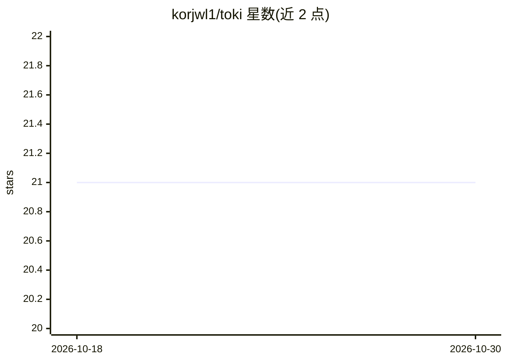

# korjwl1/toki

⭐ 21 · Rust · MIT · 推送 2026-08-27 · [GitHub](https://github.com/korjwl1/toki) · 个人维护

**Claude Code 与 Codex CLI 的令牌用量追踪守护进程**

Rust 编写的守护进程/客户端架构工具：后台守护进程监视 Claude Code 与 Codex CLI 的会话日志文件，解析 JSONL 事件中的用量元数据，写入按 provider 分区的嵌入式 TSDB（fjall），不存储提示词或响应正文。提供实时事件流（trace）、使用报告（report）、PromQL 风格查询、限流窗口追踪、基于 LiteLLM 定价的成本估算，以及可选的多设备同步。面向使用多个 AI CLI 工具且需要细粒度用量分析的开发者。macOS/Linux 通过 Homebrew 安装。

## 筛选速览

| 维度 | 判定 | 备注 |
|---|---|---|
| AI 角色 | `ai-ecosystem` | LLM/agent 周边工具 |
| 许可风险 | `permissive` | MIT |
| 部署形态 | `None` |  |
| 模型依赖 | — | README 未给出锁定关系 |
| 硬件要求 | — | 无带数字的原话,不猜 |
| 安装摩擦 | `low` | 无编译、无系统依赖或容器化 |
| 成熟度 | — | 结构信号不足 |

## 能力要点

- 守护进程增量索引会话日志，实测报告查询约 7 ms（2 GB 数据集）
- Per-model/per-session/per-project/per-day 维度分解，支持 PromQL 风格查询与成本估算
- 默认本地运行，仅存储时间戳、模型、会话 ID、token 计数等元数据，不存储提示词或响应正文
- 支持 Claude Code 与 Codex CLI 统一视图，可自建 sync server 跨设备聚合（TLS、批压缩、断线 delta 同步）

## 适用场景

- 追踪我在 Claude Code 和 Codex CLI 上的 token 消耗与成本
- 查看限流窗口状态，避免撞到额度上限
- 跨多台机器聚合 token 用量到一个自托管服务器

## 场景标签

`LLM 可观测性` · 领域:评测与运维

## 证据(README 行号)

> L54: - **daemon** — watches session logs from configured providers (Claude Code, Codex CLI), parses events, writes to pe
> L158: - **Local by default**: parsing and local reports stay on your machine. The daemon may check GitHub for new releas

## 星数曲线

2026-10-18 21 → 2026-10-30 21（+0）

---
*卡片 v1 · prompt 1.4 · 生成 2026-10-28 · 置信度 high · 依据 README sha `c72e7044f494` · [字段定义](../../DATASET.md)*
