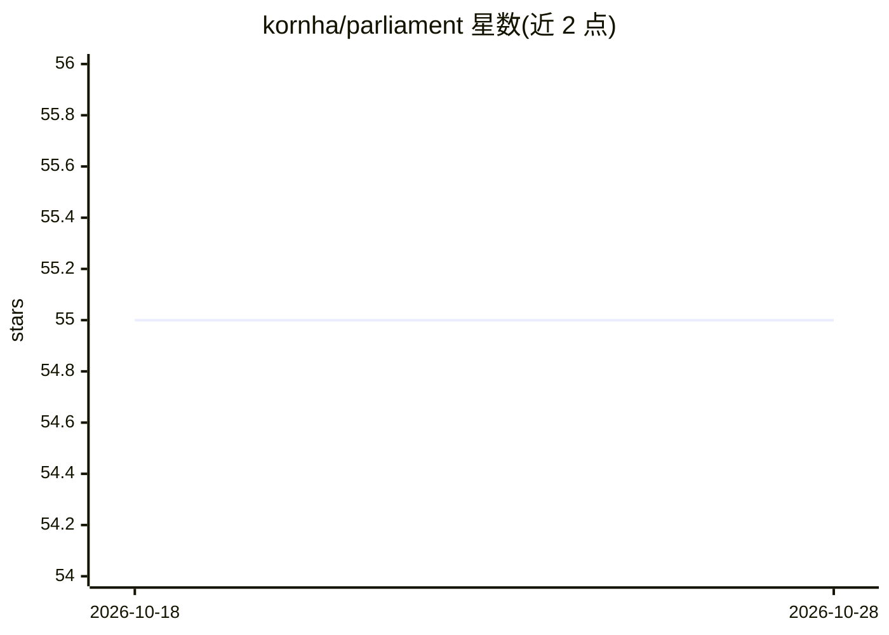

# kornha/parliament

⭐ 55 · Dart · NOASSERTION · 推送 2026-08-14 · [GitHub](https://github.com/kornha/parliament) · 个人维护

**按置信度/偏见/新闻价值组织新闻的开源新闻平台（预发布）**

开源新闻项目（预发布阶段），基于白皮书 Consensus News。核心机制：将新闻来源抽象为 Entity，按其历史说法正确率计算类似信用分的 Confidence 分数（0.0–1.0，不可达两端点），声明置信度取相关实体均值并随 Consensus 变化更新；Bias 以 0–360 度角表示，用圆桌就座类比将实体按左右中极分组（马蹄铁理论）；Newsworthiness 定义为跨偏见群体对故事新闻价值的共识。技术栈含 Flutter 与 Node.js，提供托管网站与 iOS 应用，任何人可在遵守 LICENSE 前提下自托管。

## 筛选速览

| 维度 | 判定 | 备注 |
|---|---|---|
| AI 角色 | `ai-enhanced` | 去掉 AI 部分产品仍成立 |
| 许可风险 | `none` | NOASSERTION |
| 部署形态 | `None` |  |
| 模型依赖 | — | README 未给出锁定关系 |
| 硬件要求 | — | 无带数字的原话,不猜 |
| 安装摩擦 | `low` | 无编译、无系统依赖或容器化 |
| 成熟度 | `idea` | |

## 能力要点

- 基于实体历史正确率计算类信用分的 Confidence 算法
- 以角度（0–360°）建模政治偏见并按左/中/右/极分组
- Newsworthiness 定义为跨偏见共识的新闻价值评分
- 可自托管，配套白皮书 Consensus News 与 iOS 应用

## 适用场景

- 以可量化的置信度和偏见标注方式阅读新闻
- 研究共识式新闻评分算法（Confidence/Bias/Newsworthiness）
- 在遵守 LICENSE 前提下自托管一个新闻平台实例

## 场景标签

 · 领域:新闻/媒体

## 证据(README 行号)

> L7: **Parliament** is an open-source news project that organizes news by `Confidence`, `Bias`, `Newsworthiness`, and `Co
> L14: * Parliament is based on the whitepaper Consensus News.

## 星数曲线

2026-10-18 55 → 2026-10-28 55（+0）

---
*卡片 v1 · prompt 1.4 · 生成 2026-10-24 · 置信度 low · 依据 README sha `5888751a4983` · [字段定义](../../DATASET.md)*
