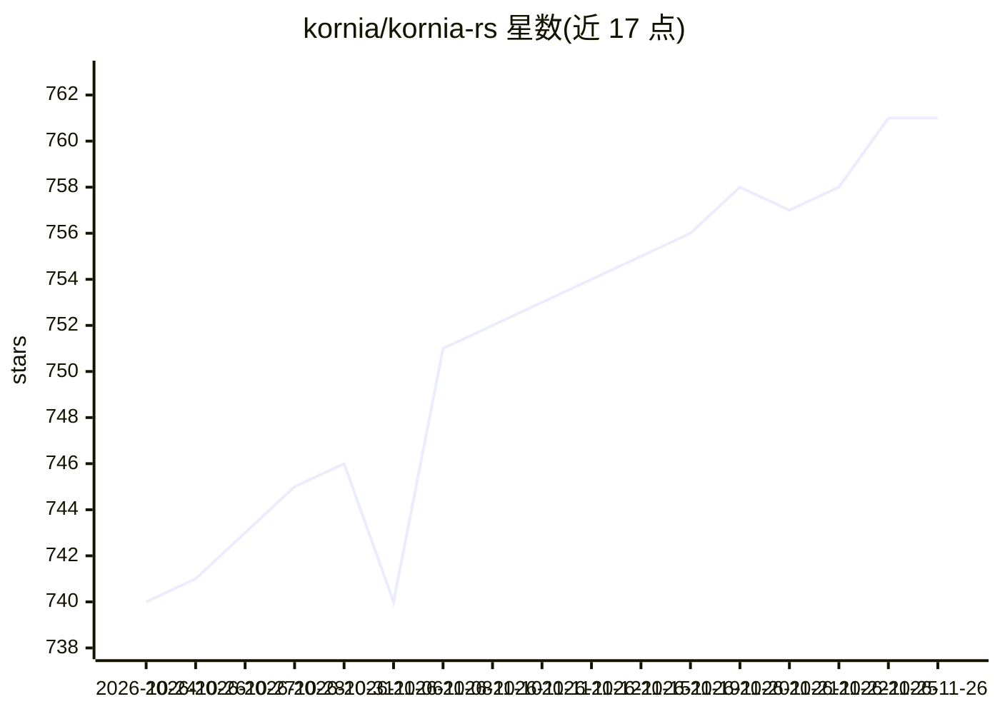

# kornia/kornia-rs

⭐ 761 · Rust · Apache-2.0 · 推送 2026-11-23 · [GitHub](https://github.com/kornia/kornia-rs) · [官网](https://docs.rs/kornia) · 组织维护

**Rust 底层 3D/图像视觉库：CPU/GPU 图像 I/O 与处理**

面向 Rust 与 Python 的低层计算机视觉库，提供线程安全的图像读写（15+ 格式）、SIMD/CUDA 加速的图像处理算子，以及 V4L2 相机捕获。通过 DLPack 与 CUDA Array Interface 与 PyTorch、TensorRT 零拷贝互操作，Preprocessor 将 NV12→归一化 CHW 融合为单个 CUDA kernel，用于实时相机推理管线。经 PyO3/Maturin 打包发布 PyPI wheel，CPU/GPU 同一包按环境惰性加载 CUDA；另提供仿射光束平差等几何功能。

## 筛选速览

| 维度 | 判定 | 备注 |
|---|---|---|
| AI 角色 | `ai-native` | 本体是模型或模型工具 |
| 许可风险 | `permissive` | Apache-2.0 |
| 部署形态 | `library` | 以包/库形式分发 |
| 模型依赖 | — | README 未给出锁定关系 |
| 硬件要求 | `cpu-ok` | |
| 安装摩擦 | `medium` | 含编译或系统依赖之一 |
| 成熟度 | — | 结构信号不足 |

## 能力要点

- 同一 Image 与算子在 CPU/NVIDIA GPU 上按数据驻留自动分发
- 经 DLPack 与 __cuda_array_interface__ 与 PyTorch 零拷贝互操作
- Preprocessor 将 resize/normalize/HWC→CHW 融合为单个 CUDA kernel
- 支持 AVIF 到 WebP 共 15 种图像格式读取与 uint16 深度图

## 适用场景

- 为实时相机推理管线做 GPU 驻留的预处理
- 在 Rust 项目中做线程安全的图像 I/O 与处理
- 将图像张量零拷贝交给 PyTorch/TensorRT 推理
- 多视角点云的仿射光束平差求解

## 场景标签

`图像视频处理` · 领域:感知与多模态

## 证据(README 行号)

> L13: The `kornia` crate is a low-level computer vision library for Rust 🦀
> L15: Fast, thread-safe image I/O and processing with a single API that runs on the CPU or an NVIDIA GPU — the same `Imag
> L47: - 🎥 Real-time ready: V4L2 camera capture and a fused NV12/YUYV → normalized CHW CUDA kernel for inference.

## 星数曲线

2026-10-24 740 → 2026-11-26 761（+21）

---
*卡片 v1 · prompt 1.4 · 生成 2026-11-24 · 置信度 high · 依据 README sha `7f6cb4c54f57` · [字段定义](../../DATASET.md)*
