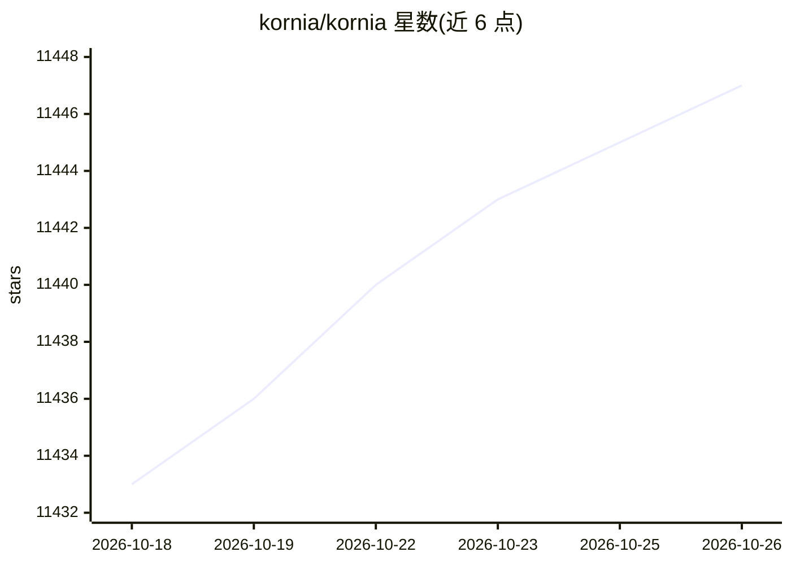

# kornia/kornia

⭐ 11,447 · Python · Apache-2.0 · 推送 2026-10-24 · [GitHub](https://github.com/kornia/kornia) · [官网](https://kornia.readthedocs.io) · 组织维护 · 中文 README

**基于 PyTorch 的可微分计算机视觉与几何运算库**

构建在 PyTorch 之上的可微分计算机视觉库，提供超过 500 个算子，覆盖图像处理、数据增强、特征检测与匹配、相机几何、立体视觉、位姿估计、光流、损失函数等类别，并内置人脸检测、特征匹配、分割等预训练模型（YuNet、LoFTR、LightGlue、SAM、MobileViT 等），支持批处理、自动微分与 GPU 加速，面向深度学习研究与 AI 工作流开发者。README 以表格列出各模块在 float16/bfloat16 半精度下的通过率与已知失败项。通过 pip 安装，开发环境使用 pixi 管理。

## 筛选速览

| 维度 | 判定 | 备注 |
|---|---|---|
| AI 角色 | `ai-native` | 本体是模型或模型工具 |
| 许可风险 | `permissive` | Apache-2.0 |
| 部署形态 | `library` | 以包/库形式分发 |
| 模型依赖 | — | README 未给出锁定关系 |
| 硬件要求 | — | 无带数字的原话,不猜 |
| 安装摩擦 | `medium` | 含编译或系统依赖之一 |
| 成熟度 | — | 结构信号不足 |

## 能力要点

- 500+ 可微算子：图像处理、几何变换、滤波、边缘检测、形态学等
- 内置预训练模型：人脸检测 YuNet、匹配 LoFTR/LightGlue、分割 SAM、分类 MobileViT/ViT
- 特征检测/描述/匹配（Harris、SIFT、DISK、AdaLAM 等）与相机标定、对极几何、PnP、光流
- 半精度支持状态表：逐模块列出 float16/bfloat16 已知失败项与通过率

## 适用场景

- 在深度学习训练管线中做可微分的图像变换与数据增强
- 实现特征匹配、单应估计、立体视觉与位姿估计等几何视觉任务
- 复用 SSIM/PSNR/Dice 等视觉损失函数组合到自定义网络

## 场景标签

`图像视频处理` · 领域:感知与多模态

## 证据(README 行号)

> L21: **Kornia** is a differentiable computer vision library that provides a rich set of differentiable image processing 
> L38: Leverage pre-trained AI models optimized for a variety of vision tasks, all within the Kornia ecosystem.
> L42:  - **Segmentation**: SAM

## 星数曲线

2026-10-18 11,433 → 2026-10-26 11,447（+14）

---
*卡片 v1 · prompt 1.4 · 生成 2026-10-20 · 置信度 high · 依据 README sha `14b652c16e57` · [字段定义](../../DATASET.md)*
