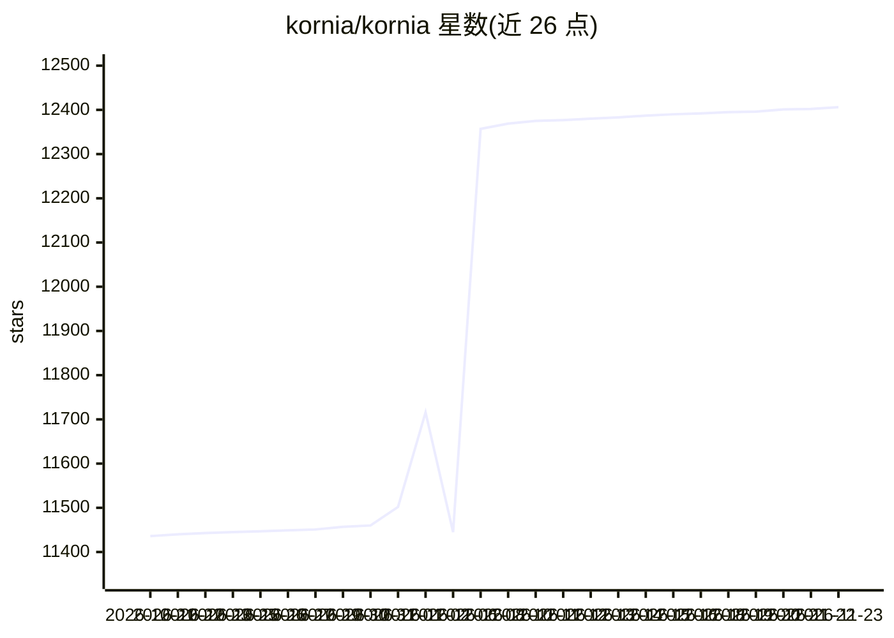

# kornia/kornia

⭐ 12,406 · Python · Apache-2.0 · 推送 2026-11-20 · [GitHub](https://github.com/kornia/kornia) · [官网](https://kornia.readthedocs.io) · 组织维护 · 中文 README

**面向空间 AI 开发者的可微分几何计算机视觉 PyTorch 库**

基于 PyTorch 的可微分计算机视觉库，提供 1,200+ 公开算子，覆盖相机模型与对极几何、RANSAC 鲁棒估计、特征检测描述与匹配、图像增强、形态学、损失函数等；支持逐样本参数的批量调用、CPU/CUDA/MPS 张量与 float16/bfloat16、torch.compile 与超过 1,000 个算子的 ONNX 导出。附预训练模型（YuNet 人脸检测、LoFTR/LightGlue 特征匹配、SAM 分割等）。由志愿者维护，通过 PyPI 安装。

## 筛选速览

| 维度 | 判定 | 备注 |
|---|---|---|
| AI 角色 | `ai-native` | 本体是模型或模型工具 |
| 许可风险 | `permissive` | Apache-2.0 |
| 部署形态 | `library` | 以包/库形式分发 |
| 模型依赖 | — | README 未给出锁定关系 |
| 硬件要求 | — | 无带数字的原话,不猜 |
| 安装摩擦 | `medium` | 含编译或系统依赖之一 |
| 成熟度 | — | 结构信号不足 |

## 能力要点

- 1,200+ 可微分算子，含相机模型、对极几何、RANSAC、PnP 求解器
- AugmentationSequential 对图像/掩码/框/关键点同步变换并可逆
- 支持 CPU/CUDA/MPS 与 float16/bfloat16，1,000+ 算子可导出 ONNX
- 内置 LoFTR、LightGlue、SAM、YuNet 等预训练模型

## 适用场景

- 为深度学习训练构建批量可微分的数据增强流水线
- SLAM/机器人中的几何估计：本质矩阵、单应矩阵、PnP 求解
- GPU 上批量执行特征检测、描述与匹配
- 将视觉算子导出为 ONNX 部署

## 场景标签

`图像视频处理` `目标检测` · 领域:感知与多模态

## 证据(README 行号)

> L21: **Kornia** is a differentiable computer vision library that provides a rich set of differentiable image processing 
> L83: 3. **AI Models**

## 星数曲线

2026-10-21 11,436 → 2026-11-23 12,406（+970）

---
*卡片 v1 · prompt 1.4 · 生成 2026-11-22 · 置信度 high · 依据 README sha `09a6bc52bc18` · [字段定义](../../DATASET.md)*
