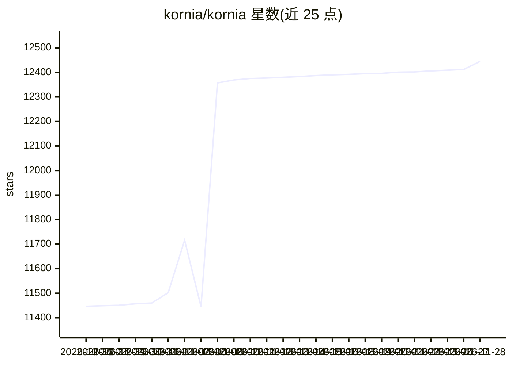

# kornia/kornia

⭐ 12,445 · Python · Apache-2.0 · 推送 2026-11-25 · [GitHub](https://github.com/kornia/kornia) · [官网](https://kornia.readthedocs.io) · 组织维护

**基于 PyTorch 的可微几何计算机视觉库，面向空间 AI 开发**

构建于 PyTorch 之上的可微计算机视觉库，提供 1200+ 公开算子，涵盖相机模型、对极几何、最小解算器与 RANSAC、特征检测/描述/匹配、图像处理与增广等，输入在何设备上即在何设备上运行，无 NumPy 往返。支持批量逐样本参数调用、保留梯度的可微几何变换，以及 SIFT、DISK、LoFTR、LightGlue 等本地特征方法；多数算子支持 torch.compile 与 ONNX 导出。以 PyPI 包分发，接受 CPU/CUDA/MPS 张量，float16/bfloat16 依算子限制支持。

## 筛选速览

| 维度 | 判定 | 备注 |
|---|---|---|
| AI 角色 | `ai-native` | 本体是模型或模型工具 |
| 许可风险 | `permissive` | Apache-2.0 |
| 部署形态 | `library` | 以包/库形式分发 |
| 模型依赖 | — | README 未给出锁定关系 |
| 硬件要求 | — | 无带数字的原话,不猜 |
| 安装摩擦 | `medium` | 含编译或系统依赖之一 |
| 成熟度 | — | 结构信号不足 |

## 能力要点

- 1200+ 公开算子，覆盖几何、特征、增广、形态学等类别
- 批量调用支持逐样本参数（sigma、角度、变换矩阵按 batch 传入）
- 可微几何：depth_to_3d_v2、相机模型（Brown–Conrady/Kannala–Brandt）、李群 So3/Se3
- 1000+ 算子可导出 ONNX，多数配置可在 torch.compile 下运行

## 适用场景

- 为深度学习训练构建带标注的图像增广流水线
- 在 GPU 上批量执行几何变换与特征匹配
- 做相机标定、位姿估计与三维重建相关开发
- 将视觉算子导出 ONNX 部署到其他运行时

## 场景标签

`图像视频处理` · 领域:感知与多模态

## 证据(README 行号)

> L21: **Kornia** is a differentiable computer vision library that provides a rich set of differentiable image processing 
> L83: 3. **AI Models**
> L84: Leverage pre-trained AI models optimized for a variety of vision tasks, all within the Kornia ecosystem.

## 星数曲线

2026-10-26 11,447 → 2026-11-28 12,445（+998）

---
*卡片 v1 · prompt 1.4 · 生成 2026-11-26 · 置信度 high · 依据 README sha `5bbe296e269b` · [字段定义](../../DATASET.md)*
