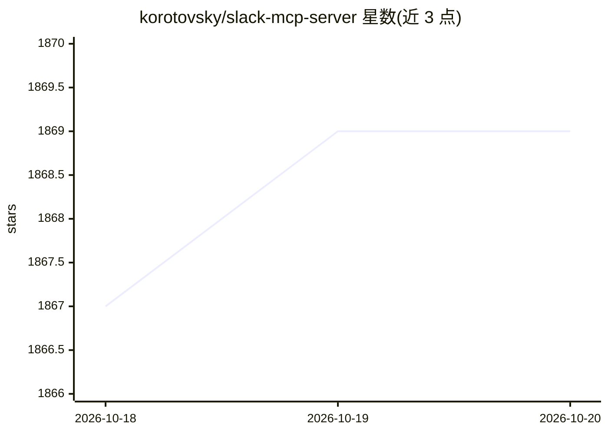

# korotovsky/slack-mcp-server

⭐ 1,869 · Go · MIT · 推送 2026-07-16 · [GitHub](https://github.com/korotovsky/slack-mcp-server) · 个人维护

**让 MCP 客户端读写 Slack 工作区的 MCP 服务器**

面向 Slack 工作区的 Model Context Protocol 服务器，供支持 Stdio/SSE/HTTP 传输的 MCP 客户端调用。提供 9 个工具：按频道名或 ID 拉取频道与线程历史（按日期或条数分页）、跨频道/DM 搜索消息、列出频道与用户组、搜索用户、添加消息与表情回应（发消息和表情操作默认禁用，需环境变量开启并可限定频道）。支持 OAuth 令牌与无需额外权限的 stealth 模式，兼容 Enterprise/GovSlack 场景，可配置代理，内置用户与频道缓存。

## 筛选速览

| 维度 | 判定 | 备注 |
|---|---|---|
| AI 角色 | `ai-ecosystem` | LLM/agent 周边工具 |
| 许可风险 | `permissive` | MIT |
| 部署形态 | `library` | 以包/库形式分发 |
| 模型依赖 | — | README 未给出锁定关系 |
| 硬件要求 | — | 无带数字的原话,不猜 |
| 安装摩擦 | `low` | 无编译、无系统依赖或容器化 |
| 成熟度 | — | 结构信号不足 |

## 能力要点

- 9 个工具覆盖历史读取、搜索、发消息、表情回应、用户与用户组查询
- OAuth 与 stealth（无需工作区权限/机器人安装）两种模式
- 发消息与表情操作默认禁用，经环境变量开启且可限定频道白名单
- Stdio/SSE/HTTP 三种传输与出站代理配置

## 适用场景

- 让 AI 助手读取并检索 Slack 频道、线程和私信内容
- 通过 AI 客户端在指定频道发消息或添加表情回应
- 在企业/GovSlack 环境下接入工作区消息数据

## 场景标签

 · 领域:LLM 工具/协作平台接入

## 证据(README 行号)

> L4: Model Context Protocol (MCP) server for Slack Workspaces. The most powerful MCP Slack server — supports Stdio, SSE a
> L22: - **Stdio/SSE/HTTP Transports & Proxy Support**: Use the server with any MCP client that supports Stdio, SSE or HTT

## 星数曲线

2026-10-18 1,867 → 2026-10-20 1,869（+2）

---
*卡片 v1 · prompt 1.4 · 生成 2026-10-18 · 置信度 high · 依据 README sha `442bc137ab5e` · [字段定义](../../DATASET.md)*
