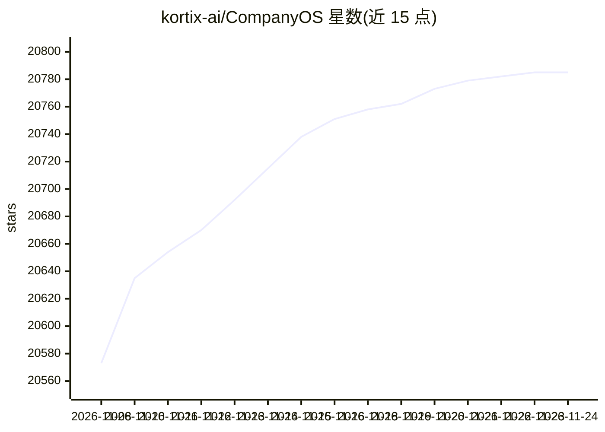

# kortix-ai/CompanyOS

⭐ 20,789 · TypeScript · NOASSERTION · 推送 2026-11-24 · [GitHub](https://github.com/kortix-ai/CompanyOS) · [官网](https://kortix.com) · 组织维护

**开源企业级多智能体运行平台：常驻 AI 代理按事件驱动执行公司工作**

面向企业的云原生 agent harness：用户在 pi 上编写自定义代理，由 Kortix 部署到云端，每个会话运行在独立的云计算机上并持久化状态。提供事件驱动触发（定时/ webhook/连接器事件）、My Kortix 路由代理、多代理并行 swarm、变更经人工审批的 change request、3000+ 应用连接器、LLM 网关与角色权限/SSO。代理、技能与规则以文件形式存于一个 git 仓库（company as code）。支持 Kortix Cloud、VPC 或本地自托管（Docker Compose），可使用自有模型 key。

## 筛选速览

| 维度 | 判定 | 备注 |
|---|---|---|
| AI 角色 | `ai-ecosystem` | LLM/agent 周边工具 |
| 许可风险 | `none` | NOASSERTION |
| 部署形态 | `self-host` | docker 或自建部署 |
| 模型依赖 | — | README 未给出锁定关系 |
| 硬件要求 | — | 无带数字的原话,不猜 |
| 安装摩擦 | `low` | 无编译、无系统依赖或容器化 |
| 成熟度 | — | 结构信号不足 |

## 能力要点

- 事件驱动的常驻代理：定时任务、签名 webhook、连接器事件触发
- 每会话独立云计算机，闲置休眠、唤醒后保留完整历史
- 代理、技能、规则、连接器全部存于一个 git 仓库（company as code）
- 自托管为 Docker Compose 栈，与托管云使用相同镜像

## 适用场景

- 团队共享同一套代理、技能与公司记忆协同工作
- 让代理按计划或事件 24/7 自主完成任务并经审批落地变更
- 在自有 VPC 或本地机房自托管，数据不出企业基础设施

## 场景标签

`多智能体` `Agent 框架` · 领域:Agent 开发

## 证据(README 行号)

> L5: **The open-source CompanyOS: the cloud-native agent harness for companies.**
> L34: Kortix CompanyOS takes the session out of the person's hands. It is a **cloud-native agent harness**: you
> L35: write custom agents on pi, an open-source agent harness, and Kortix deploys them to the cloud and

## 星数曲线

2026-11-08 20,573 → 2026-11-24 20,785（+212）

---
*卡片 v1 · prompt 1.4 · 生成 2026-11-17 · 置信度 high · 依据 README sha `aed89c93e7f5` · [字段定义](../../DATASET.md)*
