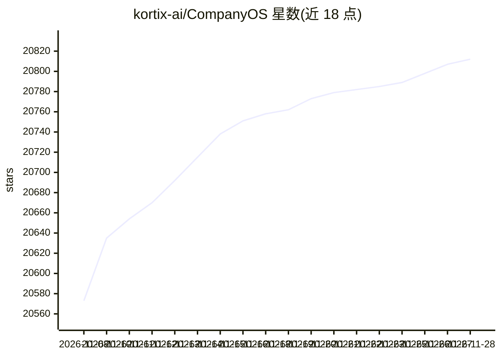

# kortix-ai/CompanyOS

⭐ 20,812 · TypeScript · NOASSERTION · 推送 2026-11-27 · [GitHub](https://github.com/kortix-ai/CompanyOS) · [官网](https://kortix.com) · 组织维护

**团队级 AI agent 编排与托管操作系统平台**

面向企业的开源 agent 运行平台：把 agent、技能、记忆和连接器集中在一个自有 git 仓库中声明（company as code），由调度、webhook、连接器事件等触发器启动 agent，每个会话在独立云端沙箱计算机上运行并持久化状态，支持多 agent 并行 swarm、变更审批、LLM 网关与预算控制。提供 CLI、REST API 与 TypeScript SDK；可托管云使用，也可通过 Docker Compose 在自有 VPC 或本地环境自托管。

## 筛选速览

| 维度 | 判定 | 备注 |
|---|---|---|
| AI 角色 | `ai-ecosystem` | LLM/agent 周边工具 |
| 许可风险 | `none` | NOASSERTION |
| 部署形态 | `self-host` | docker 或自建部署 |
| 模型依赖 | — | README 未给出锁定关系 |
| 硬件要求 | — | 无带数字的原话,不猜 |
| 安装摩擦 | `low` | 无编译、无系统依赖或容器化 |
| 成熟度 | — | 结构信号不足 |

## 能力要点

- agent、技能、记忆、连接器以文件形式存于单一 git 仓库
- 事件驱动触发：调度、签名 webhook、连接器与 App 事件
- 每会话独立云端沙箱计算机，空闲休眠、唤醒保留状态
- 支持自托管（VPC/on-prem），LLM 网关统一管理模型与预算

## 适用场景

- 让 agent 按调度和事件 24/7 执行公司流程任务
- 团队共享同一批 agent、技能与公司记忆协作
- 在自有云或内网环境自托管整套 agent 平台
- 通过 change request 审批 agent 产出的变更

## 场景标签

`多智能体` `Agent 框架` · 领域:Agent 开发

## 证据(README 行号)

> L35: Kortix CompanyOS takes the session out of the person's hands. It is a **cloud-native agent harness**: you
> L66: |**Reach**|People work from the web, desktop and mobile apps, the terminal, Slack, Microsoft Teams and email, and f
> L76: |**Models**|Kortix-managed models, your own provider keys, a ChatGPT subscription or a Claude subscription. Every r

## 星数曲线

2026-11-08 20,573 → 2026-11-28 20,812（+239）

---
*卡片 v1 · prompt 1.4 · 生成 2026-11-28 · 置信度 high · 依据 README sha `9a0a0c844b7d` · [字段定义](../../DATASET.md)*
